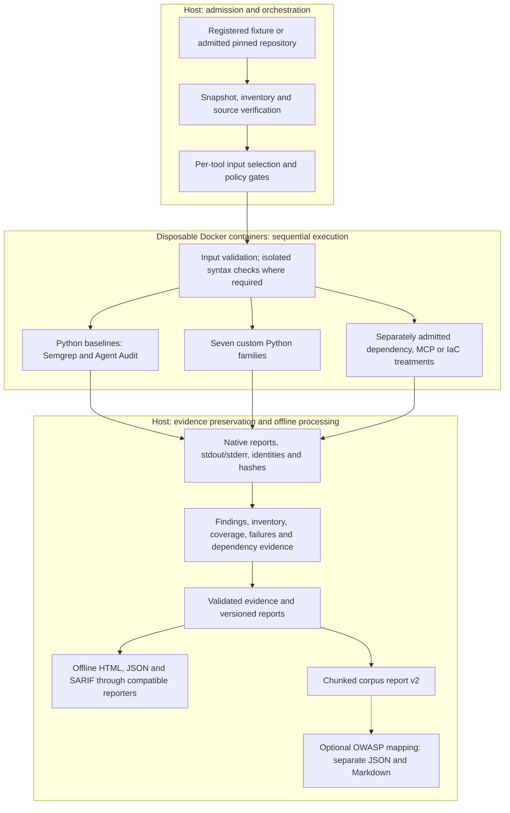

# agentsec-evidence

`agentsec-evidence` is a CLI-first research platform for orchestrating security tools,
preserving native evidence, producing provenance-aware normalized records, exporting SARIF,
and measuring evidence quality for AI-agent repositories.

For a prepared Windows environment, follow the
[controlled scan-to-HTML demo](#controlled-scan-to-html-demo). It uses one registered
development example, not an arbitrary repository or the full twenty-repository collection.

**Start here:** [Current scope](#current-scope) | [Code and evidence review](#start-reviewing-here) |
[Reporting routes](#reporting-routes) | [Environment](#development-environment) |
[Earlier pilot evidence](#earlier-pilot-evidence) | [Publication limits](#publication-status)

## Architecture

Execution and reporting are separate. Admitted inputs go through pinned tools in isolated
containers; retained evidence is then validated and processed offline. Different treatment
contracts have their own reporters, not one interchangeable input format.



This is the shared execution pattern, not a claim that every scanner runs on every input.
Containers receive read-only targets, denied networking and no Docker socket or host home.
Target code, dependencies, tests and live agents are not executed. Refusals, failures and
unrun stages remain explicit; missing evidence is not a clean result. The source pilot's
Dockerfile is unsupported by the selected KICS profile, so KICS does not run in that pilot.
The dependency treatment keeps direct OSV and Syft -> CycloneDX -> OSV as separate paths.
The twenty-repository core is Python-only; dependency, MCP JSON and IaC evidence comes
from separate pilots or controlled cases. OWASP mapping does not scan code or modify HTML.

## Current Scope

The current implementation is a working CLI prototype, not a complete agent-security product.
It integrates established scanners and evaluates how their evidence is preserved, compared,
and reported. It does not implement a replacement SAST engine.

The completed Python collection contains **20 pinned repositories**, with three repetitions.
The fixed Semgrep and Agent Audit baselines ran on **13 eligible repository selections**;
seven larger selections exceeded the frozen baseline harness limits and remain explicitly
unsupported. That boundary describes this harness, not the upstream tools' maximum capacity.
The collection is descriptive, not a held-out accuracy benchmark. Existing dependency,
MCP configuration and infrastructure evidence is separate from this Python core.

| Area | Implemented capability | Evidence boundary |
|---|---|---|
| Code | Pinned Semgrep execution, normalization and SARIF | Controlled cases and 13 eligible selections in the 20-repository Python collection; 68 unchanged GitLab rules |
| Infrastructure-as-Code | Pinned KICS execution, normalization and SARIF | Selected Terraform/Kubernetes queries and authored fixtures |
| Dependencies | Direct OSV analysis compared with Syft -> CycloneDX -> OSV | Controlled PyPI cases and two pinned public-repository lockfiles |
| Agent artifacts | Bounded validation worker -> pinned Agent Audit -> normalized evidence and SARIF | Controlled cases, URL contrasts and 13 eligible Python selections; Qdrant MCP JSON is separate evidence; per-file completion remains unknown |
| Project-authored static families | Seven isolated workers, versioned conditions and explicit inventory/deferred rules | Shared controlled validation and all 20 admitted Python selections; file-local syntax is not runtime exploitability |
| Artifact inventory and Git evidence | Filename candidates, commit/tree/blob replay and explicit all-file input decisions | Controlled cases and the admitted pinned collection; inventory breadth is not detection breadth |
| Selected input views | Verified byte copies, full-context policy guards and isolated Python/MCP validation | Controlled cases and explicitly approved pilot selections; a valid view alone does not authorize scanning |
| Research Semgrep | Pinned 68-rule candidate with separate research and repository-policy views | Controlled cases and 309 selected Python files across 13 eligible repositories; no unrestricted repository admission or comprehensive SAST claim |
| Reporting and replay | Common JSON/HTML, versioned corpus reports, contextual review companions and SARIF projections | Views, repetitions, refusals and dependency paths remain separate; review proposals are not confirmed vulnerabilities |
| OWASP Agentic mapping | Version-bound, offline JSON/Markdown relationships over retained corpus reports | Three proposed rule relationships, not full Top 10 coverage, compliance or new detection |

Five custom families emit narrow security-condition records: tool execution, network/data
transfer, filesystem access, memory/state and self-modification. Orchestration and
agent-to-agent analysis are inventory-first; they do not emit active security-condition
findings. Seven implemented families do not mean comprehensive coverage of seven risk areas.

Public-source execution uses separately admitted finite contracts, not arbitrary repositories. Prompts, skills,
memory, permissions and agent communication have no comprehensive dedicated treatment here.
Offline HTML replaces the planned web UI. Bounded benchmark governance and scoring are
implemented; broader intake, shareable delivery and held-out evaluation remain incomplete.

### Detection Rules and Data

Custom rule metadata and implementation live in
[`src/agentsec_evidence/custom_rules/`](src/agentsec_evidence/custom_rules/).
Catalog statuses distinguish active conditions, inventory and deferred concepts; named
rule totals are not measures of detection coverage. The `*_worker.py` modules provide
the isolated execution entry points.

| Custom family | Rule definitions | Current treatment |
|---|---|---|
| Tool execution | [Rule metadata](src/agentsec_evidence/custom_rules/tool_execution.py), [annotation-aware implementation](src/agentsec_evidence/custom_rules/tool_execution_v2.py) | 1.1.0; narrow syntax conditions, with 1.0.0 preserved for historical replay |
| Network and data transfer | [Catalog](src/agentsec_evidence/custom_rules/network_catalog.py) | Conditions, inventory and deferred checks |
| Filesystem access | [Catalog](src/agentsec_evidence/custom_rules/filesystem_catalog.py) | Conditions, inventory and deferred checks |
| Memory and state | [Catalog](src/agentsec_evidence/custom_rules/memory_catalog.py) | Conditions, inventory and deferred checks |
| Self-modification | [Catalog](src/agentsec_evidence/custom_rules/self_modification_catalog.py) | Conditions, inventory and deferred checks |
| Orchestration | [Catalog](src/agentsec_evidence/custom_rules/orchestration_catalog.py) | Inventory-first; no active condition findings |
| Agent-to-agent | [Catalog](src/agentsec_evidence/custom_rules/agent_to_agent_catalog.py) | Inventory-first; no active condition findings |

For the admitted public pilots, detection uses existing tools under explicit, pinned profiles:

- **Semgrep:** all 68 pinned, unchanged GitLab Python rules in the
  [candidate profile](configs/research/semgrep-python-candidate-v1.json), applied in separate
  research and repository-policy views. This is not comprehensive Python or agent-security coverage.
- **Agent Audit:** the pinned analyzer's existing static detection rules, using the
  [public-pilot configuration](configs/tools/agent-audit-pilot.toml).
- **Dependencies:** Syft discovers packages and exports CycloneDX; OSV matches reported packages
  against the frozen offline vulnerability database. The direct lockfile-to-OSV path uses the
  same database and settings. [Dependency method](docs/dependency-pilot.md).
- **KICS:** integrated and tested separately with selected Terraform/Kubernetes queries, but
  not run on these pilots: their Dockerfiles are outside the [selected profile](configs/tools/kics.toml).

The original controlled integration test uses a small project-authored
[`eval(...)` Semgrep rule](rules/project-authored/semgrep-first-slice.yml). It is a fixture-only
evidence-pipeline check, not part of the public pilot's 68-rule pack or a comprehensive custom
agent-security ruleset. Input selection, isolation, suppression handling and evidence validation
are platform controls, distinct from the scanners' detection rules.

## Start Reviewing Here

| Review question | Entry points |
|---|---|
| Which repositories and evaluation protocol were selected? | [Pinned candidate manifest](test_cases/corpus/candidates-2026-10-21.json), [collection protocol](docs/corpus-collection-protocol.md), [eligibility and preflight](docs/corpus-preflight.md) |
| How are admission and tool execution controlled? | [Input validation](docs/corpus-input-validation.md), [core execution](docs/corpus-core-execution.md), [collection driver](docs/corpus-collection-driver.md), [execution code](src/agentsec_evidence/corpus/execution.py) |
| Where are our rules, baselines and expected cases? | [Custom families](#detection-rules-and-data), [Semgrep profile](configs/research/semgrep-python-candidate-v1.json), [Python/MCP cases](test_cases/development/agent-artifacts/cases.json), [dependency expectations](test_cases/development/dependency-basic/expected.json) |
| How are tools connected and evidence preserved? | [Shared orchestration](src/agentsec_evidence/orchestration/shared.py), [producer adapters](src/agentsec_evidence/adapters/), [Docker safety tests](tests/security/test_docker_plan.py) |
| How are findings reviewed and exported? | [Contextual review companion](docs/corpus-review-report.md), [corpus SARIF](docs/corpus-sarif.md), [report-only recovery](docs/corpus-report-recovery.md) |
| What do the OWASP tags mean? | [Mapping method and CLI](docs/owasp-agentic-mapping.md), [versioned registry](profiles/owasp-agentic-2026-mapping-v1.json), [mapping implementation](tools/owasp_agentic_mapping.py) |
| How did the earlier pilot work? | [Pilot design](docs/same-repository-pilot.md), [frozen plan](test_cases/pilot/langgraph-cicd/source-pilot.json), [offline replay](src/agentsec_evidence/pilot/validation.py), [regression tests](tests/unit/test_source_pilot.py) |

The [earlier pilot summaries](#earlier-pilot-evidence) are retained measurements, not
held-out labels or current fresh scans. Native execution bundles, target archives, cached
upstream rule packs, vulnerability databases and local images are not included in Git.
The checkout contains implementation, profiles, authored cases and documentation, not
the complete private research dataset. Reproduction requires the documented preparation.

## Reporting Routes

HTML files open directly in a browser; no dashboard service or account is required.
Use the reporter for the input's exact contract. In particular, the common-report HTML
command does not accept every custom-family or corpus format.

| Retained input | Supported route and output |
|---|---|
| Compatible common reports, v1-v4 | [`report html` / `report validate-html`](docs/offline-html-report.md): portable HTML, with explicitly selected exports |
| Two-pilot custom-family evidence | [Repository evidence reporter](docs/repository-custom-rehearsal.md): source-bound JSON, SARIF and HTML |
| Twenty-repository Python core | [Chunked corpus reports](docs/corpus-report-recovery.md): summary plus per-cell JSON/HTML; [SARIF export](docs/corpus-sarif.md) is separate |
| Exactly bound contextual assessments | [Review companion](docs/corpus-review-report.md): evidence-linked HTML, keeping AI proposals separate from human decisions |
| Pinned historical benchmark sessions | [Offline scoring](docs/offline-scoring.md) and [scoring HTML](docs/offline-scoring-html.md): coverage, package-handoff, export-field, repeatability and failure tables |
| Chunked corpus report v2 | [OWASP mapping tool](docs/owasp-agentic-mapping.md): separate JSON/Markdown; no rescanning or modification of existing HTML |

OWASP Agentic 2026 mapping currently contains three proposed rule-level relationships.
It distinguishes conditions from inventory and records unmapped rules and unassessed
categories. It does not establish full Top 10 coverage, compliance or confirmed attacks.
Native tool tags remain separate from project-proposed mappings.

Reporting and scoring do not improve the scanners' underlying detection accuracy.
Tool views, repetitions, failed/refused stages and dependency paths remain separate;
missing evidence is not a clean result. Source hashes establish recorded consistency,
not independent attestation or approval of a vulnerability claim. Reports remain
internal/unredacted unless separately reviewed for distribution.

For older SARIF exports, use the [versioned review-level correction](docs/sarif-review-projection.md)
when required. It creates a new source-bound package and preserves original bytes;
the newer corpus exporter already emits review/none for unaccepted claims.

## Treatment Paths

The static evidence path is:

```text
project-authored fixture
  -> pinned Semgrep or KICS container
  -> write-once, hash-verified native evidence
  -> offline normalization
  -> SARIF 2.1.0
  -> evidence-quality summary
```

The dependency path compares two treatments of the same pinned root lockfile:

```text
uv.lock -> OSV ------------------------------------> direct evidence
uv.lock -> Syft -> native JSON + CycloneDX -> OSV ---> SBOM-path evidence
retained evidence -> validation -> common JSON / SARIF
```

Both OSV treatments use explicit shared settings and the same frozen offline database.
The original dependency experiment is lockfile-only; the later same-repository pilot also
includes the admitted Python source treatment. Neither executes the agent or installs target
dependencies, and neither establishes runtime exploitability. No findings is not proof of safety.

The [bounded Agent Audit runner](docs/agent-static-runner.md) handles the admitted Python
and MCP inputs. Its native output does not establish per-file completion, including on
zero-finding runs. The [research Semgrep treatment](docs/semgrep-research-contracts.md)
retains separate research and repository-policy views. Both disable Git ignore filtering;
the policy view applies Semgrep ignore files and inline suppressions.

[Git verification and input plans](docs/pinned-git-input-plans.md),
[artifact inventory](docs/repository-artifact-inventory.md) and
[selected views](docs/verified-input-views.md) preserve full-input context and explicit
inclusions/exclusions. Symlinks, submodules and Git LFS pointers are refused by the
current intake contract. Passing intake is not scan authorization or detection coverage.
Unrestricted repository scanning and held-out evaluation remain outside the completed scope.

### Evidence Walkthrough

Existing finalized bundles can be inspected, validated and summarized without rerunning a
scanner. Common reporting can combine their evidence into a new derivative while keeping
source labels, statuses, limitations and the two dependency paths separate. See the
[reporting commands and counting rules](docs/common-reporting.md) and
[dependency reproduction and limitations](docs/dependency-pilot.md).

Saved results must be identified as retained evidence, not presented as a live scan. Runtime
workspaces and generated outputs are not distributed in Git, so a fresh checkout does not
include the private pilot bundles or meeting reports.

### Controlled Scan-to-HTML Demo

This is a **prepared Windows/PowerShell environment** walkthrough of one registered
`python-positive` example through Agent Audit and the common HTML reporter. It demonstrates
the integrated evidence pipeline, not all seven custom families, a random GitHub repository,
or the larger corpus report format.

Prerequisites:

- Run from this development checkout, with its locked Python environment already installed
  under `.venv`. The commands use that environment directly; they do not synchronize packages.
- Docker Desktop must be running locally in Linux-container mode. Both exact image IDs in
  `configs/tools/agent-audit.toml` must be present. They are local pins, not public image tags;
  cloning this repository is insufficient. See [private image recovery](docs/agent-image-reproduction.md)
  for a separately provisioned environment. Do not pull replacements or change pins for a demo.
- Each fresh scan requires authorization under the current research freeze. Keep demonstration
  outputs separate from the frozen collection; after the agreed experiment cutoff, use retained
  results rather than launching another scan. This guide does not reopen the study.

**Documentation status, 23 October 2026:** command interfaces and source contracts were
checked; no fresh end-to-end demonstration was run for this README update. Rehearse on the
prepared machine before relying on live execution in a meeting.

#### 1. Check the Environment

Keep the same PowerShell window for every step. Do not continue after a failed check.

```powershell
$ErrorActionPreference = 'Stop'
$PSNativeCommandUseErrorActionPreference = $false
$env:PYTHONDONTWRITEBYTECODE = '1'
$project = (Get-Location).Path
$cli = (Resolve-Path '.\.venv\Scripts\agentsec-evidence.exe').Path
$python = (Resolve-Path '.\.venv\Scripts\python.exe').Path

$dockerType = docker info --format '{{.OSType}}'
if ($LASTEXITCODE -ne 0 -or $dockerType -ne 'linux') {
    throw 'A running local Docker Linux engine is required.'
}

$configJson = & $python -B -c "import json,pathlib,tomllib; print(json.dumps(tomllib.loads(pathlib.Path('configs/tools/agent-audit.toml').read_text())))"
if ($LASTEXITCODE -ne 0) { throw 'Could not read the pinned image configuration.' }
$config = $configJson | ConvertFrom-Json
foreach ($image in @($config.image, $config.validator_image)) {
    docker image inspect $image --format '{{.Id}}'
    if ($LASTEXITCODE -ne 0) { throw 'A required pinned image is missing. Stop here.' }
}
```

The first check should report Linux via `$dockerType`; the image checks print the two IDs.
These checks do not pull images, start a scanner or execute target code.

#### 2. Display the Input and Run One Scan

The fixture passes a tool argument to `eval`. Display its text; do not run it with Python
or install its imports. The CLI accepts the registered case ID, not a repository URL.
Every attempt below receives a separate workspace and new report destinations.

```powershell
$cases = Get-Content '.\test_cases\development\agent-artifacts\cases.json' -Raw | ConvertFrom-Json
($cases.cases | Where-Object id -eq 'python-positive').content

$tag = (Get-Date -Format 'yyyyMMdd-HHmmss') + '-' + [guid]::NewGuid().ToString('N').Substring(0, 8)
$workspace = Join-Path $project "workspace\live-demo-$tag"
$common = Join-Path $project "outputs\live-demo-$tag-common"
$html = Join-Path $project "outputs\live-demo-$tag-html"
foreach ($path in @($workspace, $common, $html)) {
    if (Test-Path -LiteralPath $path) { throw "Destination already exists: $path" }
}
New-Item -ItemType Directory -Force (Join-Path $project 'outputs') | Out-Null

$raw = & $cli scan agent-audit python-positive --workspace $workspace --json
$scanExit = $LASTEXITCODE
if ($scanExit -notin @(0, 8)) {
    $raw
    throw "Scan stopped with exit $scanExit. Preserve the attempt; do not retry silently."
}
$scan = ($raw -join "`n") | ConvertFrom-Json
if (-not $scan.run_id -or -not $scan.run_root) { throw 'Missing run identity.' }
$scan | Select-Object run_id, terminal_state, semantic_sha256
```

Exit `8` means **partial analysis**, not a clean result. This Agent Audit treatment cannot
prove per-file completion, even when native output parses and the pipeline finishes.
Exit `0` means workflow completion, not absence of vulnerabilities. Other exits stop this
walkthrough: `2` command/input error, `4` execution failure, `5` parsing/validation failure,
and `6` admission refusal. Do not interpret a failed command as zero findings.

#### 3. Validate the Evidence and Generate HTML

Use the run identity returned by the scan; do not guess it or reuse a historical run ID.
The following steps process the recorded output without launching another scanner.

```powershell
& $cli validate $scan.run_id --workspace $workspace --json
if ($LASTEXITCODE -ne 0) { throw 'Evidence validation failed.' }

& $cli report build $scan.run_root --output $common
if ($LASTEXITCODE -ne 0) { throw 'Common report generation failed.' }

& $cli report html $common --output $html
if ($LASTEXITCODE -ne 0) { throw 'HTML generation failed.' }

& $cli report validate-html $html
if ($LASTEXITCODE -ne 0) { throw 'HTML package validation failed.' }

Invoke-Item (Join-Path $html 'report.html')
```

Open the generated report's source, analysis-status and scanner-report sections. Validation
checks the declared evidence/package contracts; it does not confirm vulnerability claims or
establish complete SARIF consumer interoperability. No additional evidence exports are selected.
The HTML is internal and unredacted, with no automatic secret masking or public-release clearance.

The retained historical positive example produced four overlapping native reports. Those
are not four independent vulnerabilities. Its upstream shell-oriented classification of the
`eval` observation is a known interpretation concern, not an endorsed mapping. Inspect the
new result instead of promising a particular count before execution. See the
[runner's interpretation limits](docs/agent-static-runner.md#interpretation).

The raw run remains under `$scan.run_root`; the common report is under `$common`, and the
portable HTML folder is under `$html`. Preserve failed attempts and existing bundles.
If execution is unavailable during a meeting, open a prepared report and explicitly identify
it as retained output, not a fresh scan. The source bytes, rules and historical results must
not be edited to make a demonstration succeed.

## Development Environment

- CPython 3.13.15
- uv 0.12.6
- Docker Desktop with Linux containers for scanner execution
- Native Windows/PowerShell CLI development

The documented uv baseline above is unchanged. The 2 October Windows refresh used installed
uv 0.12.13: the frozen lock and installed-dependency checks passed without changing application
dependencies. This observed host-version drift is recorded in the [preflight receipt](docs/agent-audit-preflight.md).

```powershell
uv sync --frozen --all-groups
uv run agentsec-evidence doctor --strict
uv run ruff check .
uv run mypy src tests
uv run pytest
```

The global Python environment is unsupported. Scanner containers receive read-only target
mounts, no Docker socket or host credentials, and denied networking in the static profile.

## Development Runs

From this repository in PowerShell:

```powershell
uv run agentsec-evidence scan semgrep `
  .\test_cases\development\semgrep-basic\target `
  --label fixture:semgrep-basic `
  --revision fixture-v1 `
  --source-kind project-fixture `
  --license-status project-authored-private
```

Run the pinned KICS development treatment:

```powershell
uv run agentsec-evidence scan kics `
  .\test_cases\development\kics-basic\target `
  --label fixture:kics-basic `
  --revision fixture-v1 `
  --source-kind project-fixture `
  --license-status project-authored-private
```

Findings do not make `scan` fail. System outcomes use separate exit codes: `0` complete,
`8` partial, `4` execution/timeout, `5` parse/validation, and `6` safety refusal.

Finalized data can be processed without invoking the producer again:

```powershell
uv run agentsec-evidence inspect <run-id> --json
uv run agentsec-evidence validate <run-id> --json
uv run agentsec-evidence summarize <run-id> --json
uv run agentsec-evidence normalize <run-id> --output .\outputs\normalization
uv run agentsec-evidence export sarif <run-id> --output .\outputs\results.sarif
```

Offline derivatives must be written outside the finalized run bundle.

## Evidence Flow

The original single-producer run-bundle path is shown below. Repository and corpus
treatments have separately versioned envelopes; use their [reporting routes](#reporting-routes).

```text
source directory
  -> deterministic snapshot and inventory
  -> trusted Docker argv plan
  -> pinned scanner image (network none; target read-only)
  -> bounded stdout, stderr, native JSON, and optional native comparison output
  -> exact-byte content-addressed blob store
  -> strict offline parser
  -> finding, coverage, and failure JSONL
  -> deterministic SARIF export
  -> schema, provenance, SARIF, and bundle validation
  -> finalized manifest
```

One finalized single-producer run contains:

```text
run.json                         events.jsonl
target/snapshot.json             target/inventory.jsonl
executions/<id>/execution.json   executions/<id>/stdout.bin
executions/<id>/stderr.bin       executions/<id>/inputs/*
executions/<id>/native/*         executions/<id>/parser-report.json
executions/<id>/blobs.json
normalized/findings.jsonl        normalized/coverage.jsonl
normalized/failures.jsonl        exports/results.sarif
exports/summary.json             validation/{schema,sarif,provenance}.json
bundle-manifest.json
```

Raw, normalized, and export products are classified `internal` by default. A future public
release operation must perform an explicit allowlist/redaction step; a valid bundle is not a
public-safe bundle.

## Repeatability Semantics

`run-semantic-v2` compares stable target, tool, configuration, parser-accounting, normalized,
failure, coverage, and SARIF semantics. It excludes opaque run/record IDs, timestamps, runtime
duration, and exact raw-blob locator hashes. Producer-native outputs may include timing and
runtime metadata, so exact native hashes can differ across otherwise equivalent runs. Those
bytes and hashes remain preserved and independently validated in every bundle.

The first real three-run fixture check produced one native and normalized finding per run,
zero failures, complete provenance, schema-validated SARIF, and one identical semantic SHA-256 across
all three runs. This verifies evidence handling repeatability only; it is not a detection claim.
The later corpus uses its own declared per-treatment semantic projections; repeats are
not independent samples and byte-identical raw output is not required.

The KICS treatment pins image digest, source revision, built-in query-pack inventory hash,
platforms, query IDs, parser controls, and output formats in `configs/tools/kics.toml`. The
native JSON is canonical; native KICS SARIF is retained only as a comparison artifact. A zero
finding result is distinct from an unsupported target or a partial parse.

## Earlier Pilot Evidence

These formative experiments established integration behavior before the wider Python
collection. Their optional-stage results are not pooled into the twenty-repository core.

### Dependency Evidence Pilot (2026-09-18)

The [dependency pilot](docs/dependency-pilot.md) compares direct `uv.lock` -> OSV with
Syft -> native JSON/CycloneDX -> OSV using explicit settings and one frozen PyPI database.
The finite controlled scope was reviewed by the student. The public pilot used
`langchain-samples/cicd-pipeline-example` at `5ab0d0a0f3c90999f786f834d9c05484dfe5f2bf`:
159 eligible PyPI identities across all lockfile markers/groups, with the editable root counted
separately. No target dependencies, tests, builds or agents were executed. No paid service
or hosted model was required; zero advisory matches were retained as a valid result.

Package name/version projection retention is reported separately from lost source qualifiers;
occurrences and native relationships are retained but their full fidelity is not scored.
Reported package appearance does not prove successful per-package vulnerability matching.
The direct and SBOM paths remain separate in [common reporting](docs/common-reporting.md).

### Complete Source Preparation

[Source preparation](docs/pinned-source-preparation.md) verifies complete Git evidence,
snapshot bytes and the artifact inventory, retaining failures and refusing unsupported inputs.
The reusable [offline intake](docs/repository-intake.md) exposes `target prepare-git` and
`target verify-git` for externally pinned cached evidence. Neither command launches a
scanner; new repositories still require separate admission and input selection.

### Same-Repository Source Pilot

The [bounded pilot runner](docs/same-repository-pilot.md) connects verified source intake,
the unchanged 68-rule Semgrep candidate in two policy views, Agent Audit static analysis,
and both frozen dependency paths on one revision. Its fixed treatment selects all 26 Python
files from the 47-file inventory and runs three sequential repetitions without target
execution. Its pilot envelope is separate from controlled-case common-report contracts.
Dockerfile remains unsupported; broad inventory is not comprehensive detection coverage.
Use fresh output directories and retain failed attempts. This is formative integration
evidence, not a held-out accuracy benchmark or completion of the full project.

#### Retained Pilot Results

Target: `langchain-samples/cicd-pipeline-example` at
`5ab0d0a0f3c90999f786f834d9c05484dfe5f2bf`. The following observations repeat across all
three runs. See [merged PR #15](https://github.com/MuminjonGuru/Project-Sonic/pull/15) for
the published engineering verification summary and scope limits.

| Treatment | Observation per repetition | Interpretation |
|---|---|---|
| Semgrep research | 0 reports; 26 reported scanned paths | Rule-by-file completion is not established |
| Semgrep repository-policy | 0 reports; 12 reported scanned paths | Different coverage; native exclusions and directory context retained |
| Agent Audit | 8 reports; native aggregate file count 21 | Reports remain unreviewed; per-file completion unknown for the 26 selected inputs |
| Direct OSV and Syft/CycloneDX/OSV | Both retain 159 eligible PyPI name/version pairs plus a separate local root; 0 advisory matches | Frozen database only; source-qualifier and relationship limitations remain |
| KICS | Not run on the observed Dockerfile | Unsupported by this pilot profile, not a clean scan |

The completed attempt has 18 stage rows: six stages repeated three times. Each stage's
declared semantic projection matched across repetitions; raw outputs remain retained.
Repeats are not independent cases, and eight reports repeated three times are not 24 unique
vulnerabilities. Neither no findings nor package-count equality establishes security or full
evidence fidelity. Manual preparation and review effort were not timed.

The first attempt stopped on directory-level ignore evidence. Its failure was preserved;
the reconciler was corrected without changing target, rules, versions or scanner policy.
[Public-pilot common reporting](docs/public-pilot-reporting.md) replays the sealed pilot
into `common-report-v4`: 18 stage rows and 15 SARIF runs, not a combined vulnerability total.

### Second Formative Pilot: Qdrant MCP

The [Qdrant contract](docs/qdrant-pilot.md) uses revision
`c56ae5adf62bb78d852bf7bbcbc5d7b75e2bbe41`, keeping Python, actual MCP JSON and both
dependency paths separate. All seven stages repeat semantically across three repetitions.
The MCP analyzer reports an unversioned `uvx` launch; this is not proof of runtime compromise.
All 111 eligible lockfile identities survive the name/version projection, with qualifier
losses retained. Raw evidence stays local; see the [repository reporter](docs/repository-custom-rehearsal.md)
for its separate JSON/SARIF/HTML path.

### Custom-Family Repository Rehearsal

The [custom-family rehearsal](docs/repository-custom-rehearsal.md) binds all seven workers
to the same verified Python files in the two earlier pilots, with three repetitions.
Tool-execution 1.1.0 corrects postponed-annotation handling while preserving 1.0.0 and
historical outputs. The other six workers and baseline rule packs are unchanged. Native
findings, inventory, deferred IDs, tool views and limitations remain separate. This
controlled integration history is distinct from the wider descriptive corpus.

## Benchmark Governance

[Planning](docs/benchmark-plans.md) binds exact inputs, expectations, configuration and
source hashes. [Bounded execution](docs/benchmark-attempts.md) uses sequential write-once
attempts and verified terminal reuse. Validation/dry-run does not establish runtime readiness.
Opt-in v2 retry is limited to the documented missing-Docker failure before container launch;
other failures and interruptions are not silently retried. Corpus report-only recovery is
a separate treatment that preserves the failure and does not rerun completed scans.

| Registered treatment | Method and limits |
|---|---|
| Original Semgrep and KICS fixtures | [Semgrep handler](docs/benchmark-semgrep.md), [KICS handler](docs/benchmark-kics.md); not broader SAST or Dockerfile support |
| Direct and SBOM dependency paths | [Dependency handler](docs/benchmark-dependencies.md); separate package/match accounting |
| Deliberate SBOM handoff changes | [Mutation handler](docs/benchmark-dependency-mutations.md); authored discrepancies, not upstream scanner defects |
| Empty, unresolved, malformed or unsupported dependency input | [Boundary handler](docs/benchmark-dependency-boundaries.md); unknown/refused states remain explicit |
| Fixed three-repetition source pilot | [Public-pilot handler](docs/benchmark-public-pilot.md); whole-attempt reuse, no per-stage retry |
| Controlled agent research cases | [Execution](docs/controlled-research-execution.md), [ledger](docs/benchmark-research.md); expectations remain separate from producer output |

Offline scoring and HTML presentation are implemented for their documented historical
inputs. The collected corpus has frozen treatment/input bindings and retained attempts;
this does not make it held-out evaluation. Wider intake, independently reviewed outcomes
and independent-machine reproducibility remain outside the demonstrated scope.

## Repository Boundary

All implementation, tests, fixtures, benchmark definitions, runtime workspaces, and generated
outputs live under this repository. Planning and decision history remains in the sibling
phase folders, including `Project_Phase_04`; those private records are not distributed
in this checkout. Runtime workspaces, generated reports and raw evidence remain ignored.
Implementation commits do not automatically publish the research dataset or meeting materials.

## Publication Status

The source-license and university intellectual-property decision is not yet resolved. This is
currently a private research implementation; no permission to redistribute the source is
granted by the absence of a license file.
