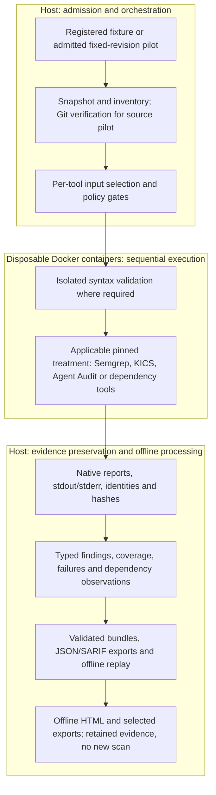

# agentsec-evidence

`agentsec-evidence` is a CLI-first research platform for orchestrating security tools,
preserving native evidence, producing provenance-aware normalized records, exporting SARIF,
and measuring evidence quality for AI-agent repositories.

## Architecture

Offline scoring now reads pinned historical benchmark sessions without rerunning scanners.
It produces separate coverage, package-handoff, export-field, repeatability and failure tables,
with explicit unknowns and review provenance. See [offline scoring](docs/offline-scoring.md)
for `score build`, `score validate` and original-source replay. These are evidence-quality
measurements, not an overall safety score or public-pilot accuracy result.

Separate [benchmark HTML](docs/offline-scoring-html.md) presents retained scoring tables with
session, case, stage and repetition boundaries: `score html` and `score validate-html`.
This internal, unredacted view preserves unknowns and historical failures; it is not a new scan
or a pooled repository security score. Only explicitly selected scoring exports are copied.

Offline [HTML reporting](docs/offline-html-report.md) now presents an existing common report
and optional bound review history as a portable folder. `report html` does not rerun scanners;
`report validate-html` checks the generated package. Reports remain internal and unredacted.



This is the shared execution pattern, not a claim that every scanner runs on every input.
Containers receive read-only targets, denied networking and no Docker socket or host home.
Target code, dependencies, tests and live agents are not executed. Refusals, failures and
unrun stages remain explicit; missing evidence is not a clean result. The source pilot's
Dockerfile is unsupported by the selected KICS profile, so KICS does not run in that pilot.
The dependency treatment keeps direct OSV and Syft -> CycloneDX -> OSV as separate paths.

## Current Scope

The current implementation is a working CLI prototype, not a complete agent-security product.
It integrates established scanners and evaluates how their evidence is preserved, compared,
and reported. It does not implement a replacement SAST engine.

| Area | Implemented capability | Evidence boundary |
|---|---|---|
| Code | Pinned Semgrep execution, normalization and SARIF | Authored fixtures and two admitted public Python pilots; the 68-rule research profile remains a candidate |
| Infrastructure-as-Code | Pinned KICS execution, normalization and SARIF | Selected Terraform/Kubernetes queries and authored fixtures |
| Dependencies | Direct OSV analysis compared with Syft -> CycloneDX -> OSV | Controlled PyPI cases and two pinned public-repository lockfiles |
| Agent artifacts | Bounded validation worker -> pinned Agent Audit -> normalized evidence and SARIF | Thirteen baseline cases, four URL contrasts and two admitted public pilots, including Qdrant MCP JSON; per-file completion remains unknown |
| Project-authored static families | Seven isolated workers, versioned conditions and explicit inventory/deferred rules | Shared authored validation and the two admitted Python pilots; file-local syntax is not runtime exploitability |
| Artifact inventory and Git evidence | Filename candidates, commit/tree/blob replay and explicit all-file input decisions | Controlled cases; 47 files in the original pilot and 34 in Qdrant; inventory breadth is not detection breadth |
| Selected input views | Verified byte copies, full-context policy guards and isolated Python/MCP validation | Controlled cases and explicitly approved pilot selections; a valid view alone does not authorize scanning |
| Research Semgrep | Pinned 68-rule candidate with separate research and repository-policy views | Controlled cases; 26 Python files in the original pilot and 19 in Qdrant; no general admission or final profile freeze |
| Reporting and replay | Static/dependency/agent bundles and controlled research cases in common JSON/SARIF; dedicated public-pilot report and replay | Views, repetitions, refusals and dependency paths remain separate; no combined vulnerability total |

Public-source execution uses separately admitted finite contracts, not arbitrary repositories. Prompts, skills,
memory, permissions and agent communication have no comprehensive dedicated treatment here.
Offline HTML replaces the planned web UI. Bounded benchmark governance and scoring are
implemented; broader intake, shareable delivery and held-out evaluation remain incomplete.

### Detection Rules and Data

The [corpus preflight](docs/corpus-preflight.md) records twenty pinned candidates and checks
complete Git bytes, selected Python paths, license evidence and unchanged stage size/policy
limits. It does not scan those candidates or admit arbitrary URLs. The two existing pilots
remain distinct from the eighteen prospective descriptive-study candidates; oversized baseline
selections are explicit, never silently sharded or truncated.

The next [isolated input-validation gate](docs/corpus-input-validation.md) binds prepared
candidate inputs to bounded syntax-worker evidence and explicit per-tool eligibility. It
does not run detectors or establish vulnerability coverage. The
[descriptive collection protocol](docs/corpus-collection-protocol.md) fixes three repetitions
and the bounded review sample before new corpus findings are collected.

For the admitted public pilots, detection uses existing tools under explicit, pinned profiles:

- **Semgrep:** all 68 pinned, unchanged GitLab Python rules in the
  [candidate profile](configs/research/semgrep-python-candidate-v1.json), applied in separate
  research and repository-policy views. This is not comprehensive Python or agent-security coverage.
- **Agent Audit:** the pinned analyzer's existing static detection rules, using the
  [public-pilot configuration](configs/tools/agent-audit-pilot.toml).
- **Dependencies:** Syft discovers packages and exports CycloneDX; OSV matches reported packages
  against the frozen offline vulnerability database. The direct lockfile-to-OSV path uses the
  same database and settings. [Dependency method](docs/dependency-pilot.md).
- **KICS:** integrated and tested separately with selected Terraform/Kubernetes queries, but
  not run on these pilots: their Dockerfiles are outside the [selected profile](configs/tools/kics.toml).

The original controlled integration test uses a small project-authored
[`eval(...)` Semgrep rule](rules/project-authored/semgrep-first-slice.yml). It is a fixture-only
evidence-pipeline check, not part of the public pilot's 68-rule pack or a comprehensive custom
agent-security ruleset. Input selection, isolation, suppression handling and evidence validation
are platform controls, distinct from the scanners' detection rules.

### Second Formative Pilot: Qdrant MCP

The [Qdrant execution and replay contract](docs/qdrant-pilot.md) adds three sequential repetitions
at `c56ae5adf62bb78d852bf7bbcbc5d7b75e2bbe41`, keeping Python, actual MCP JSON and both dependency
paths separate. All seven stages repeat semantically. The MCP analyzer reports an unversioned
`uvx` launch; other reports require source context, not automatic vulnerability acceptance.
All 111 eligible lockfile identities survive the name/version projection, but qualifier losses
remain explicit. Raw evidence stays local. Source-bound JSON/SARIF/HTML reporting for this
contract is provided by the separate [repository evidence reporter](docs/repository-custom-rehearsal.md);
it is not loaded as the original pilot or shown as comprehensive coverage.

### Custom-Family Repository Rehearsal

The [additive rehearsal](docs/repository-custom-rehearsal.md) binds all seven custom families
to the same verified Python files in the two existing pilots, with three repetitions and
offline JSON/SARIF/HTML reporting. Tool-execution 1.1.0 corrects postponed-annotation handling;
the original 1.0.0 analyzer and historical evidence remain intact. The other six workers and
baseline rule packs are unchanged. Custom findings, inventory, deferred IDs, native baselines
and analysis limitations stay separate. The new CLI modules and reproducibility commands are
documented in that guide; wider repositories still require explicit admission.

## Start Reviewing Here

| Review question | Entry points |
|---|---|
| What exactly was approved and measured? | [Pilot design and invocation flow](docs/same-repository-pilot.md), [frozen source-pilot plan](test_cases/pilot/langgraph-cicd/source-pilot.json), [candidate rule profile](configs/research/semgrep-python-candidate-v1.json) |
| How are tools connected and evidence preserved? | [Pilot runner](src/agentsec_evidence/pilot/runner.py), [shared orchestration](src/agentsec_evidence/orchestration/shared.py), [producer adapters](src/agentsec_evidence/adapters/) |
| Can retained results be checked without rescanning? | [Offline pilot replay](src/agentsec_evidence/pilot/validation.py), [replay helper](tools/verify_source_pilot.py), [reporting contracts](docs/common-reporting.md) |
| What guards and expected cases exist? | [Python/MCP case registry](test_cases/development/agent-artifacts/cases.json), [authored dependency expectations](test_cases/development/dependency-basic/expected.json), [pilot regression tests](tests/unit/test_source_pilot.py), [Docker safety tests](tests/security/test_docker_plan.py) |

The [pilot results below](#same-repository-source-pilot) summarize retained measurements.
Native execution bundles, target archives, rule files and images are not included in the
checkout. Reproduction needs their documented preparation; opening the repository alone
does not provide the raw pilot dataset. The results are formative evidence, not held-out labels.

## Treatment Paths

The static evidence path is:

```text
project-authored fixture
  -> pinned Semgrep or KICS container
  -> write-once, hash-verified native evidence
  -> offline normalization
  -> SARIF 2.1.0
  -> evidence-quality summary
```

The dependency path compares two treatments of the same pinned root lockfile:

```text
uv.lock -> OSV ------------------------------------> direct evidence
uv.lock -> Syft -> native JSON + CycloneDX -> OSV ---> SBOM-path evidence
retained evidence -> validation -> common JSON / SARIF
```

Both OSV treatments use explicit shared settings and the same frozen offline database.
The original dependency experiment is lockfile-only; the later same-repository pilot also
includes the admitted Python source treatment. Neither executes the agent or installs target
dependencies, and neither establishes runtime exploitability. No findings is not proof of safety.

The first agreed agent-specific integration scope is Python tool definitions and MCP JSON
configurations. The [bounded agent CLI and reporting path](docs/agent-static-runner.md) now
connects the [artifact contracts](docs/agent-artifact-contracts.md) and
[input guards/native parser](docs/agent-input-parser.md) to isolated execution. It refuses
unhandled policy, malformed and unsupported inputs before scanning. Native per-file completion
is not observable, so admitted runs remain explicitly partial, including zero-finding runs.
This path requires two pinned local images; fresh-checkout image distribution remains open.
The [repository inventory library](docs/repository-artifact-inventory.md) now retains all supplied
files and identifies limited filename candidates, including instructions and skills. Memory and
identity recognition remain explicitly unknown; filename matching is not security-check coverage.
The [Git verification and input-plan library](docs/pinned-git-input-plans.md) now provides a
separate offline completeness check for supplied Git evidence and explicit selected/excluded
decisions for every file. Loaded receipts require raw-evidence replay. Symlinks, submodules and
Git LFS pointers are refused; a valid plan does not authorize execution or bypass policy checks.
The [selected-view bridge](docs/verified-input-views.md) now materializes exact selected bytes and
connects the bounded validation worker without discarding the full inventory's policy context.
Passing this input gate does not grant scanner permission or establish security coverage.
A general public-repository workflow, the local UI and held-out evaluation remain pending;
the fixed cached-source pilot is separately admitted through its frozen plan.

The [research Semgrep contracts](docs/semgrep-research-contracts.md) now preserve file exclusions,
native suppression and incomplete-analysis evidence without altering the first-slice profiles.
All 68 pinned GitLab Python rules remain a candidate, not a claim of comprehensive detection.
The library alone does not authorize public-source scanning; the fixed pilot helper applies
the separately approved treatment. It does not provide unrestricted directory scanning.
The [offline reporting extension](docs/research-common-reporting.md) now replays sealed controlled
cases into `common-report-v3`; older source combinations retain v1/v2. It preserves both views,
repetitions, input refusals and native evidence links without rerunning tools.

The [guarded research bridge](docs/guarded-research-runner.md) connects verified inputs to the
candidate on registered development cases; the fixed pilot reuses its guards under a separate
admission. Both views disable implicit Git ignore filtering;
the policy view applies Semgrep ignore files and inline suppressions only. Policy exclusions,
syntax refusal, process failure and incomplete native analysis remain distinct evidence.

### Evidence Walkthrough

Existing finalized bundles can be inspected, validated and summarized without rerunning a
scanner. Common reporting can combine their evidence into a new derivative while keeping
source labels, statuses, limitations and the two dependency paths separate. See the
[reporting commands and counting rules](docs/common-reporting.md) and
[dependency reproduction and limitations](docs/dependency-pilot.md).

Saved results must be identified as retained evidence, not presented as a live scan. Runtime
workspaces and generated outputs are not distributed in Git, so a fresh checkout does not
include the private pilot bundles or meeting reports.

## Development Environment

- CPython 3.13.15
- uv 0.12.6
- Docker Desktop with Linux containers for scanner execution
- Native Windows/PowerShell CLI development

The documented uv baseline above is unchanged. The 2 October Windows refresh used installed
uv 0.12.13: the frozen lock and installed-dependency checks passed without changing application
dependencies. This observed host-version drift is recorded in the [preflight receipt](docs/agent-audit-preflight.md).

```powershell
uv sync --frozen --all-groups
uv run agentsec-evidence doctor --strict
uv run ruff check .
uv run mypy src tests
uv run pytest
```

The global Python environment is unsupported. Scanner containers receive read-only target
mounts, no Docker socket or host credentials, and denied networking in the static profile.

## Development Runs

From this repository in PowerShell:

```powershell
uv run agentsec-evidence scan semgrep `
  .\test_cases\development\semgrep-basic\target `
  --label fixture:semgrep-basic `
  --revision fixture-v1 `
  --source-kind project-fixture `
  --license-status project-authored-private
```

Run the pinned KICS development treatment:

```powershell
uv run agentsec-evidence scan kics `
  .\test_cases\development\kics-basic\target `
  --label fixture:kics-basic `
  --revision fixture-v1 `
  --source-kind project-fixture `
  --license-status project-authored-private
```

Findings do not make `scan` fail. System outcomes use separate exit codes: `0` complete,
`8` partial, `4` execution/timeout, `5` parse/validation, and `6` safety refusal.

Finalized data can be processed without invoking the producer again:

```powershell
uv run agentsec-evidence inspect <run-id> --json
uv run agentsec-evidence validate <run-id> --json
uv run agentsec-evidence summarize <run-id> --json
uv run agentsec-evidence normalize <run-id> --output .\outputs\normalization
uv run agentsec-evidence export sarif <run-id> --output .\outputs\results.sarif
```

Offline derivatives must be written outside the finalized run bundle.

## Evidence Flow

```text
source directory
  -> deterministic snapshot and inventory
  -> trusted Docker argv plan
  -> pinned scanner image (network none; target read-only)
  -> bounded stdout, stderr, native JSON, and optional native comparison output
  -> exact-byte content-addressed blob store
  -> strict offline parser
  -> finding, coverage, and failure JSONL
  -> deterministic SARIF export
  -> schema, provenance, SARIF, and bundle validation
  -> finalized manifest
```

One successful run contains:

```text
run.json                         events.jsonl
target/snapshot.json             target/inventory.jsonl
executions/<id>/execution.json   executions/<id>/stdout.bin
executions/<id>/stderr.bin       executions/<id>/inputs/*
executions/<id>/native/*         executions/<id>/parser-report.json
executions/<id>/blobs.json
normalized/findings.jsonl        normalized/coverage.jsonl
normalized/failures.jsonl        exports/results.sarif
exports/summary.json             validation/{schema,sarif,provenance}.json
bundle-manifest.json
```

Raw, normalized, and export products are classified `internal` by default. A future public
release operation must perform an explicit allowlist/redaction step; a valid bundle is not a
public-safe bundle.

## Repeatability Semantics

`run-semantic-v2` compares stable target, tool, configuration, parser-accounting, normalized,
failure, coverage, and SARIF semantics. It excludes opaque run/record IDs, timestamps, runtime
duration, and exact raw-blob locator hashes. Producer-native outputs may include timing and
runtime metadata, so exact native hashes can differ across otherwise equivalent runs. Those
bytes and hashes remain preserved and independently validated in every bundle.

The first real three-run fixture check produced one native and normalized finding per run,
zero failures, complete provenance, valid OASIS SARIF, and one identical semantic SHA-256 across
all three runs. This verifies evidence handling repeatability only; it is not a detection claim.

The KICS treatment pins image digest, source revision, built-in query-pack inventory hash,
platforms, query IDs, parser controls, and output formats in `configs/tools/kics.toml`. The
native JSON is canonical; native KICS SARIF is retained only as a comparison artifact. A zero
finding result is distinct from an unsupported target or a partial parse.

## Dependency Evidence Pilot (2026-09-18)

The separately versioned `dependencies run` and `dependencies validate` commands now compare
direct root `uv.lock` -> OSV with one Syft discovery -> native JSON plus external CycloneDX ->
OSV. Both OSV paths use the same explicit configuration and frozen offline PyPI database.
See [dependency reproduction and limitations](docs/dependency-pilot.md).

The finite controlled scope was explicitly reviewed by the student. The public pilot uses
`langchain-samples/cicd-pipeline-example` at `5ab0d0a0f3c90999f786f834d9c05484dfe5f2bf`:
159 eligible PyPI identities across all lockfile markers/groups, with the editable root counted
separately. This is an admitted formative example, not the final benchmark corpus or a deployed
runtime. No dependencies, target tests, builds or agents are executed. No paid service or hosted
model is required. No findings remains a valid result, not a reason to replace this case.

Package name/version projection retention is reported separately from lost source qualifiers;
occurrences and native relationships are retained but their full fidelity is not scored.
Reported package appearance does not prove successful per-package vulnerability matching.
Dependency evidence now participates in offline common reporting, with a separately versioned
package summary and two SARIF runs for the direct and SBOM paths. Existing file-based contracts
are unchanged. See [common reporting](docs/common-reporting.md) for commands and counting rules.
The GUI, full G2 gate and coverage of all AI-agent artifacts remain open.

The dependency decision/protocol records live in the sibling `Project_Phase_02` planning
folder; active integration planning continues in `Project_Phase_03`. Neither planning folder
is distributed in this development checkout. `AGENTS.md` and `docs/` summarize the relevant
implementation guardrails. Existing supported commands and result contracts are unchanged.

Shared code lives in `src/agentsec_evidence/orchestration/shared.py`; producer planning/parsing
stays separate. `tools/verify_orchestration_regression.ps1` runs and validates the five existing
Docker fixtures and can compare against a saved baseline. Use a fresh directory under
`workspace` for its `-ReportDirectory` argument. The pinned Ubuntu verification build is in
`containers/verification/`. These checks establish engineering compatibility, not detection
accuracy or confirmatory benchmark readiness.

## Complete Source Preparation

[Pinned source preparation](docs/pinned-source-preparation.md) connects the existing cached
pilot archive to complete Git object verification, a copied snapshot and the full artifact
inventory. It retains failures and refuses unsupported input. This component verifies intake,
not vulnerabilities. Source scanning is authorized separately by the fixed plan used in the
pilot below; the original dependency evidence remains unchanged.

The additive [offline repository intake](docs/repository-intake.md) exposes
`target prepare-git` and `target verify-git` for externally pinned cached archive/raw-commit/tree
evidence. It preserves the full supported Git inventory and replays source/snapshot bytes without
downloads or scanning. New repositories still need separate scanner admission and input selection;
this does not extend the fixed pilot below into an unrestricted repository scanner.

## Same-Repository Source Pilot

The [bounded pilot runner](docs/same-repository-pilot.md) connects verified source intake,
the unchanged 68-rule Semgrep candidate in two policy views, Agent Audit static analysis,
and both frozen dependency paths on one revision. Its fixed treatment selects all 26 Python
files from the 47-file inventory and runs three sequential repetitions without target
execution. The new pilot envelope is separate from controlled-case common-report contracts.
Dockerfile remains unsupported; broad inventory is not comprehensive detection coverage.
Use fresh output directories and retain failed attempts. This is formative integration
evidence, not a held-out accuracy benchmark or completion of the full project.

### Retained Pilot Results

Target: `langchain-samples/cicd-pipeline-example` at
`5ab0d0a0f3c90999f786f834d9c05484dfe5f2bf`. The following observations repeat across all
three runs. See [merged PR #15](https://github.com/MuminjonGuru/Project-Sonic/pull/15) for
the published engineering verification summary and scope limits.

| Treatment | Observation per repetition | Interpretation |
|---|---|---|
| Semgrep research | 0 reports; 26 reported scanned paths | Rule-by-file completion is not established |
| Semgrep repository-policy | 0 reports; 12 reported scanned paths | Different coverage; native exclusions and directory context retained |
| Agent Audit | 8 reports; native aggregate file count 21 | Reports remain unreviewed; per-file completion unknown for the 26 selected inputs |
| Direct OSV and Syft/CycloneDX/OSV | Both retain 159 eligible PyPI name/version pairs plus a separate local root; 0 advisory matches | Frozen database only; source-qualifier and relationship limitations remain |
| KICS | Not run on the observed Dockerfile | Unsupported by this pilot profile, not a clean scan |

The completed attempt has 18 stage rows: six stages repeated three times. Each stage's
declared semantic projection matched across repetitions; raw outputs remain retained.
Repeats are not independent cases, and eight reports repeated three times are not 24 unique
vulnerabilities. Neither no findings nor package-count equality establishes security or full
evidence fidelity. Manual preparation and review effort were not timed.

The first attempt stopped on directory-level ignore evidence. Its failure was preserved;
the reconciler was corrected without changing target, rules, versions or scanner policy.
The dedicated pilot report and offline replay are implemented. General benchmark resume/freeze
controls, final profile justification, the UI and independent-machine delivery rehearsal remain
separate work. Local unpublished extensions are not evidence of capability in this checkout.

[Public-pilot common reporting](docs/public-pilot-reporting.md) now replays that completed
sealed pilot into `common-report-v4` without rescanning. It preserves all three repetitions,
both Semgrep policy views, the separate dependency paths, unreviewed agent findings and
coverage limitations: 18 stage rows and 15 SARIF runs, not a combined vulnerability total.

[Benchmark planning](docs/benchmark-plans.md) provides `benchmark validate` and
`benchmark dry-run` for the existing authored Python/MCP development cases. Plans bind exact
inputs, expectations, configuration and source-code hashes; validation launches no tools and
does not establish runtime readiness. [Bounded execution](docs/benchmark-attempts.md) adds
`benchmark run` and `benchmark status`: sequential, write-once attempts and verified terminal
reuse for that same authored treatment. Partial analysis and refusals remain explicit. Opt-in
v2 plans allow `benchmark retry` once per cell only for a verified missing-Docker failure before
any container launch; both attempts remain visible. Legacy plans, interruptions and all other
failures retain their no-retry boundary. The [controlled Semgrep handler](docs/benchmark-semgrep.md)
also supports the original three-file first-slice fixture through that shared runner, with exact
input/configuration bindings, offline native/export replay and no retry. This is not the 68-rule
public treatment or a new detection benchmark. The [controlled KICS handler](docs/benchmark-kics.md)
governs the four existing G2 fixtures using the unchanged two-query treatment. It preserves native
file/query counters, reports unsupported input separately from clean results and verifies evidence
before zero-launch reuse; no KICS retry or public Dockerfile support is added.
The [paired dependency handler](docs/benchmark-dependencies.md) also governs the existing basic
and corrected fixtures, binding the frozen database and replaying native evidence before reuse.
It preserves per-stage package/match counts rather than summing both vulnerability paths.
The separate [SBOM-mutation handler](docs/benchmark-dependency-mutations.md) governs the three
existing copied-export transformations and replays each change from the preserved original.
It does not label injected handoff discrepancies as upstream scanner defects.
The [governed public pilot](docs/benchmark-public-pilot.md) adds whole-attempt verified reuse
for the existing fixed three-repetition workflow, preserving all 18 stage rows. It has no
per-stage resume or retry and does not admit another target or change the scanning treatment.

The [input-boundary handler](docs/benchmark-dependency-boundaries.md) covers the four existing
empty/unresolved/malformed/unsupported fixtures, retaining missing-output and blocked-failure states.
The [controlled research producer](docs/controlled-research-execution.md) separates the
existing 15-case execution path from expected-result assertions, preserving replayable
case evidence. The [controlled research ledger](docs/benchmark-research.md) adds frozen
whole-case plans, sequential attempts and evidence-verified reuse; internal repetitions and
both policy views remain separate, and failures block without retry. Scoring, broader recovery
and final-study freeze remain separate work. The UI follows tested, reviewed and useful
results, including any justified
versioned rule/profile refinement; it is not the next implementation task.

## Repository Boundary

All implementation, tests, fixtures, benchmark definitions, runtime workspaces, and generated
outputs live under this repository. Planning and decision history remains in the sibling
`Project_Phase_02` and `Project_Phase_03` folders. Runtime workspaces and generated outputs
remain ignored; execution evidence is not automatically committed with implementation changes.

## Publication Status

The source-license and university intellectual-property decision is not yet resolved. This is
currently a private research implementation; no permission to redistribute the source is
granted by the absence of a license file.
