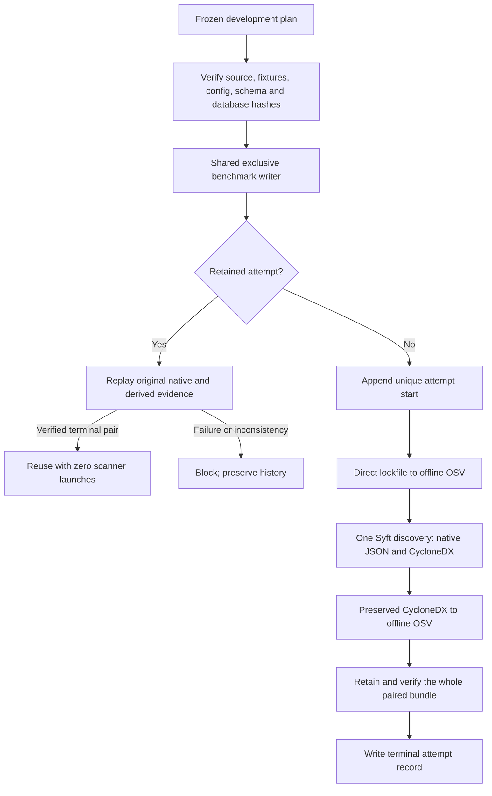

# Controlled Dependency Benchmark Governance

This additive handler governs the existing `dependency-basic` and `dependency-clean` fixtures.
It does not replace their pipeline, change scanner/data versions, or admit a new repository.
The earlier malformed, unsupported, unresolved and copied-SBOM mutation cases remain available
through their existing development helper; they are not yet cases in this benchmark handler.

## Attempt and Evidence Flow



The existing pipeline attempts its stages sequentially and retains partial failures. A missing,
failed or unverifiable stage prevents reuse of the paired attempt. There is no per-stage resume,
automatic retry or manual retry. A partially executed pair is never silently repaired. The shared
runner retains its start/finish history, blocks following cells and leaves native output in place.
Process exceptions and time/output-limit failures stop the pair immediately, even if cleanup
fails or raises; ordinary native parsing/outcome differences retain the existing collection path.

## Supported Contract

- Cases: `dev-dependency-basic-v1` and `dev-dependency-clean-v1`, one to three repetitions.
- One cell invokes direct OSV, Syft and SBOM OSV, in that order, through the existing producer.
- Exact source code, fixture bytes, finite expectation file, configuration, CycloneDX schemas,
  project lock metadata and frozen database hash are bound. Re-pinning cannot admit new inputs.
- The basic fixture's finite scope was student-approved. The corrected fixture is existing
  engineering material, not new independent adjudication. This handler retains expectations but
  does not score them or force native outcomes to match them.
- New schemas: `schemas/benchmark-dependency-v1/`. Existing contracts and receipts stay unchanged.

The database is an explicit project-relative path under `workspace/`; unsafe paths and links are
rejected. Plan preparation/validation checks its bytes without launching containers. `status` and
reuse require the same archive to reconstruct its full alias index and relevant advisory records.
There is no download or current-data fallback. Status is offline but requires this retained
database. Native argv currently binds original host paths; this handler does not claim
relocated-session replay or independent-machine reproduction.

## Commands

Run from the development root with the pinned environment and database already prepared:

```powershell
$db = 'workspace/dependency-preflight-2026-09-18/database/osv-scanner/PyPI/all.zip'
uv run python tools/prepare_development_benchmark.py `
  --treatment dependency-paired --plan-id dependency-governance-01 `
  --case dev-dependency-basic-v1 --case dev-dependency-clean-v1 `
  --repetitions 2 --database $db --output workspace/dependency-plan-01.json

uv run agentsec-evidence benchmark validate workspace/dependency-plan-01.json
uv run agentsec-evidence benchmark dry-run workspace/dependency-plan-01.json
uv run agentsec-evidence benchmark run workspace/dependency-plan-01.json --max-new-cells 1
uv run agentsec-evidence benchmark run workspace/dependency-plan-01.json
uv run agentsec-evidence benchmark status workspace/dependency-plan-01.json
```

Use a new plan filename/ID after implementation changes. Do not re-pin a completed session.
Plan validity is not Docker readiness. Completed reuse verifies the original native reports,
database entries, snapshots, normalized records and comparisons; it launches no scanner.

## What the Output Means

`finding_records` deliberately stays null at cell level. Direct and SBOM paths report separate
advisory-match counts; adding them would double-count overlapping evidence. Stage rows expose
package observations and unique PyPI name/version projections, including any reported local root;
scope fields separately identify eligible packages and local roots. These counts do not establish
complete registry-qualified identity or dependency-relationship fidelity.

The handler distinguishes completed pairs with/without reported matches, verified partial
analysis and blocked failed/interrupted attempts. Execution errors, output limits, invalid native
reports, changed inputs and unexpected flags cannot become clean outcomes. Zero findings means
no reported match against the frozen treatment, not safety. OSV all-package visibility does not
demonstrate per-package matching completion.

`workflow_complete` concerns admitted attempt processing. `analysis_complete` and
`scoring_implemented` remain false. Disagreement with an authored expectation does not by itself
invalidate a successfully retained observation; scoring belongs in MP-05.

Snapshot/config/database preparation stays outside the producer's measured pair. Attempt duration
also includes orchestration and replay. Preserve both boundaries: initial SBOM-path time includes
Syft generation; consumer-only time is a separate scenario. Same-host repetition is not a
comparative performance benchmark.

## Safety and Verification

Existing scanner bounds remain: sequential non-root containers, no network, read-only inputs,
two CPUs, 2 GiB, 256 PIDs and a 120-second stage timeout. No target installation, code execution,
dependency resolution or live agent access. Generated SBOMs stay outside the target snapshot.
The producer requests named-container cleanup if its process call raises or is interrupted;
that request alone does not prove cleanup. Unverified interrupted attempts stay blocked.

Tests cover admitted inputs, frozen-database/path controls, per-path counts, changed protected
bytes, derivative tampering, failure preservation, writer exclusion, interruption cleanup,
schemas and CLI status. Synthetic process results test orchestration; real pinned-container
rehearsals are recorded separately and are not independent research cases.

Next: govern remaining existing dependency development treatments, then separately admitted
research/pilot paths. Offline scoring and the usefulness rehearsal precede UI and delivery.
No final-study freeze or new detector is authorized by this increment.
