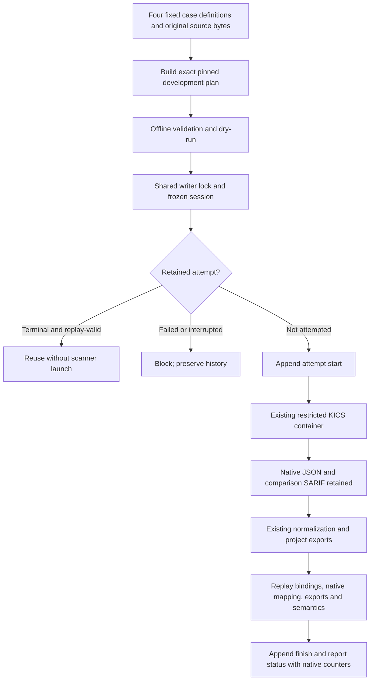

# Controlled KICS Benchmark Handler

This MP-04 increment governs the existing four G2 development fixtures through the shared
benchmark attempt runner. It does not add a scanner, query, repository or Dockerfile profile.
KICS remains pinned to v2.1.20 and the existing two Terraform/Kubernetes query IDs in
`configs/tools/kics.toml`. Target code is never executed or installed.

## Scope and Expectations

| Existing case | Inventoried files | Intended IaC inputs | Historical expectation |
|---|---:|---:|---|
| `dev-kics-basic-v1` | 5 | 4 | Two native findings; four scanned/parsed files |
| `dev-kics-clean-v1` | 2 | 2 | Zero native findings; two scanned/parsed files |
| `dev-kics-malformed-v1` | 1 | 1 | Partial analysis; one scanned, zero parsed |
| `dev-kics-unsupported-v1` | 1 | 0 | Unsupported; zero scanned/parsed files |

Expectations are copied from the unchanged case TOML files and explicitly labelled historical
engineering expectations, not independently adjudicated ground truth. They remain unscored.
A workflow result is classified from evidence, not forced to equal an expected finding count.
These cases are development material and must not become held-out evaluation cases.

Full fixture snapshots are mounted, including non-IaC text. `selected_paths` declares intended
IaC inputs; it is not a claim that a separate filtered view is mounted or every query analyzed
each file. KICS native file/query counters are aggregate observations. Per-file completion
remains unknown; unsupported input is not a true negative or evidence of safety.

## Invocation Flow



The new `benchmark-kics-plan-v1`, dry-run, finish and progress contracts are additive.
Historical agent/Semgrep schemas and bundles retain their original bytes. Attempt starts use
the existing no-retry v1 contract; KICS has neither automatic nor manual retry permission.

## Commands

Run from the repository root with the locked environment. The output parent must already
exist under the private `workspace/`; the helper refuses to overwrite an existing plan.

```powershell
uv run --frozen --offline --no-sync python tools/prepare_development_benchmark.py `
  --treatment kics-g2 --plan-id kics-development-rehearsal `
  --case dev-kics-basic-v1 --case dev-kics-clean-v1 `
  --case dev-kics-malformed-v1 --case dev-kics-unsupported-v1 `
  --repetitions 2 --output workspace/kics-plan.json

uv run --frozen --offline --no-sync agentsec-evidence benchmark validate workspace/kics-plan.json
uv run --frozen --offline --no-sync agentsec-evidence benchmark dry-run workspace/kics-plan.json
uv run --frozen --offline --no-sync agentsec-evidence benchmark run workspace/kics-plan.json --max-new-cells 1
uv run --frozen --offline --no-sync agentsec-evidence benchmark run workspace/kics-plan.json
uv run --frozen --offline --no-sync agentsec-evidence benchmark status workspace/kics-plan.json
```

Only the four explicit case IDs, with one to three sequential repetitions, are accepted. The
plan binds all four case definitions, exact target bytes, tool/profile, lock/project metadata
and current Python implementation. Re-hashing a changed fixture or treatment cannot grant
admission. Changed source requires a separate new plan; do not rewrite old sessions.

Validation, dry-run and status are offline and never launch Docker. Actual runs require the
already prepared pinned image. No pulling, network access, target execution or dependency
installation is added. Existing limits remain two CPUs, 2 GiB memory and a 120-second timeout
per scanner process, with read-only inputs, non-root containers and dropped capabilities.

## Results and Failure Boundaries

- `completed-with-findings` / `completed-without-findings`: supported native workflow
  completed under the frozen query selection, not comprehensive security analysis.
- `partial-analysis`: verified native incomplete-analysis diagnostics, including the existing
  malformed Terraform case. A zero finding count here is not a clean result.
- `unsupported`: verified native unsupported-input outcome. The container ran, but there is
  no supported IaC analysis; zero scanned files must remain visible.
- `execution-failed` / `interrupted`: block continuation. Missing Docker, invalid native JSON,
  version mismatch, missing/inconsistent native SARIF, timeout/output limits, unexpected
  findings or failed verification do not become successful terminal observations.

Parsed native counts are retained when available; failed parsing and unverified attempts use
null, not a fabricated zero. `scanner_invocations` denotes invocation attempts, not proof that
the scanner completed. `workflow_complete` means every cell has reusable terminal evidence;
`analysis_complete` and `scoring_implemented` remain false in this contract.

Before reuse, verification checks exact snapshot bytes and metadata, tool/profile/query
selection, portable sandbox invocation, original blob hashes, native JSON normalization,
parser accounting, project SARIF, summary and semantic projection. Native SARIF is checked
as a comparison artifact (format envelope and result count), never normalized as a second
producer. Byte manifests protect retained evidence; semantic hashes compare known stable
meaning while excluding declared volatile fields. Neither is independent attestation.

KICS now requests named-container cleanup when the host execution path raises an exception
or interruption. A cleanup request is not cleanup proof; unverified interrupted attempts
remain blocked. Existing success/error bundles and legacy native semantics are unchanged.

## Verification and Remaining Work

Regression tests cover the four outcomes, partial continuation, zero-launch reuse, shared
locking, exact admission, schema validation, altered native/derived/snapshot evidence,
unexpected rules/paths/counters, producer failures and interruption cleanup. Real native
repetitions and full platform-suite results are recorded separately in the local increment
receipt; test doubles do not establish real scanner behavior.

This completes only the bounded KICS handler after verification, not all MP-04. Dependency
and admitted research/pilot handlers, offline scoring, expected-outcome review and usefulness
rehearsal remain. The read-only UI and final delivery checks stay after that work.
