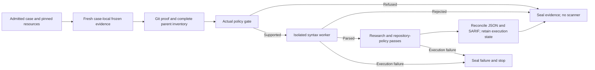

# Controlled Research Execution

MP-04 producer checkpoint, 15 October 2026. This is a library-level prerequisite for
controlled-case benchmark governance, not a second CLI or scheduler. The subsequent
[ledger adapter](benchmark-research.md) now governs these complete case executions.

## Purpose

`research.controlled.run_controlled_research_case` executes exactly one existing case from
`test_cases/development/research-runner/cases.json`. The original verification helper remains
unchanged as a historical assertion-based engineering instrument. The new producer separates
execution from expected-outcome assertions: a missing expected finding is evaluation data,
not a reason to misclassify the scanner as failed or stop subsequent evidence collection.

Only the original fifteen development cases are admitted. Registry, profile, syntax-validator
configuration and resource limits have explicit byte pins. The cached upstream rules and
license are checked against the unchanged profile. No new case, tool, rule, target, database,
dependency installation, target execution or dynamic agent test is authorized.

## Flow

The `defaults` and `inline` cases retain their original two internal repetitions. Other
scannable cases retain one. Each repetition contains separate research and repository-policy
passes; `.gitignore` remains disabled in both. Existing ignore-file and inline-suppression
behavior is unchanged. Neither view produces a confirmed-vulnerability total.

## Evidence and Failure Rules

- Freeze registry, profile, execution configuration, rules/license and trusted Python worker
  source outside the input tree. Check copied inputs before and after invocations.
- Reconstruct Git-backed fixture inventory and selected-file views with existing intake APIs.
  Policy and syntax outcomes come from those inputs, not from expected `gate` labels.
- Retain exact commands, stdout/stderr, native reports, process measurements, cleanup receipts,
  reconciliation, execution assessment and separate dual views. All containers remain pinned,
  non-root, network-disabled, read-only except bounded scratch/output, with no image pulls.
- A native warning/nonzero exit supported by the existing assessment stays incomplete evidence.
  Timeout, truncated capture, failed cleanup, missing/invalid reports and unsupported exits stop
  the attempt. Interruptions also retain failure and cleanup records.
- Refused/unrun paths do not claim zero findings. A sealed attempt is not necessarily successful.
  No prior output is overwritten or resealed; hashing shows consistency, not independent truth.
- Existing `load_research_source` and common reporting replay completed/refused case evidence.
  Unfinished executions are retained, but not admitted as a completed controlled report.

## Verification and Remaining Boundary

Synthetic regression tests exercise expectation independence, actual gates, captured failures,
cleanup, guarded paths, frozen-input changes and replay. They do not execute a real scanner.
The local native rehearsal separately exercises the fifteen admitted cases using cached rules
and existing images; its private receipts are under `workspace/benchmark-research-2026-10-15/`.

The producer itself does not implement scheduling, completed-case reuse, retry, independent
ground truth or metric scoring. The separate ledger adapter provides the versioned research
plan and exact retained command/input verification through the existing shared scheduler.
Final MP-04 acceptance follows verification of that integration; MP-05 scoring,
MP-06 usefulness review, UI and delivery remain separate.
