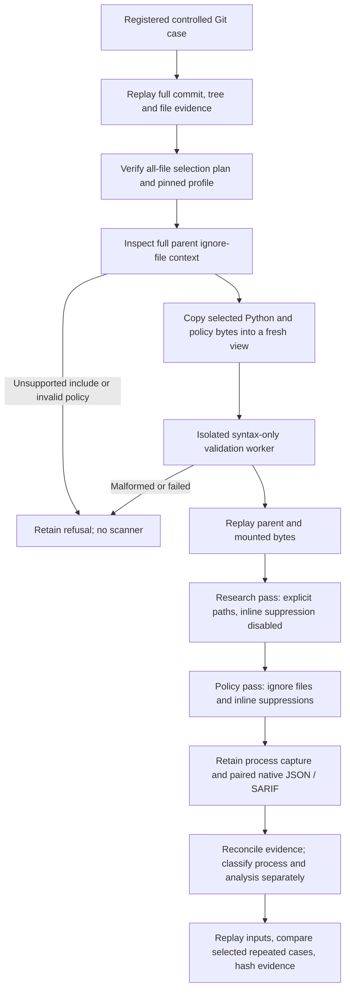

# Guarded Semgrep research runner

Status: controlled development bridge. It does **not** admit public source scans, expose an
arbitrary-path CLI, freeze a final research profile or integrate this evidence into common
reporting. Existing Semgrep fixture commands, Agent Audit policy refusals and historical bundles
are unchanged. See [the candidate contracts](semgrep-research-contracts.md).

## Treatment and evidence boundary

The candidate remains Semgrep 1.174.0 with all 68 hash-pinned GitLab Python rule files.
Both views use `--no-git-ignore`. Their deliberately explicit label is:

> Semgrep ignore files and inline suppressions; Git ignore filtering disabled

The research pass uses explicit selected Python paths and `--disable-nosem`. The policy pass
uses directory discovery on an exact-byte view of those same sources plus required policy
files. Neither pass scans unselected parent Python files. This is an offline treatment of a
selected view, **not a reconstruction of the repository's CI or full scanner configuration**.
Native policy suppression is not reviewer approval, and the two views are not additive counts.



## Policy handling

`research.policy` checks structure and read boundaries, not glob meaning. Pattern evaluation
stays in the pinned scanner. Full-parent verification happens even for files not selected for
analysis. All parent `.semgrepignore` files are inspected conservatively; an irrelevant unsafe
policy file can therefore refuse the controlled treatment.

| Condition | Handling |
|---|---|
| No root ignore file | Retain pinned native defaults |
| Empty or nonempty root ignore file | Retain it unchanged; native defaults overridden |
| Nested ignore, negation, ordinary patterns | Delegate to the pinned scanner |
| Canonical, existing local include | Preserve bytes and record owner, line, target and hash |
| Explicit `:include .gitignore` | Treat as Semgrep policy input; implicit Git filtering remains disabled |
| Absolute, drive, backslash, dot-component or escaping include | Refuse before scanner execution |
| Missing include | Refuse rather than inherit native silent omission |
| Nested include, self-include or cycle | Refuse; do not recursively expand or rewrite |
| Unknown directive, invalid UTF-8, BOM, unsafe control character | Refuse explicitly |
| Python file used as policy include | Refuse to avoid enlarging the scanner input selection |
| Source/policy combined budgets exceeded | Fail preparation; never report a clean scan |

These rules intentionally support fewer path spellings than Semgrep itself. The implementation
does not evaluate patterns, rewrite source, remove suppression markers or invent suppression
approval. Root/default and one-level include behavior were checked against the exact
[Semgrep 1.174.0 targeting implementation](https://github.com/semgrep/semgrep/blob/v1.174.0/src/targeting/Semgrepignore.ml)
and [include parser](https://github.com/semgrep/semgrep/blob/v1.174.0/libs/gitignore/Parse_gitignore.ml).
Moving documentation is not used to override pinned behavior.

## Contracts and limits

- `research.inputs` binds the original input plan to a separate mount plan. Policy copies do
  not become analysis targets. A scope alone remains metadata, not scanner authorization.
- `semgrep-policy-assessment-v1` records policy identities, include edges and blockers.
- `semgrep-execution-assessment-v1` keeps process, cleanup, report and analysis states separate.
  Reconciled exit 2 remains incomplete; timeout, resource/output limit, failed cleanup, unexpected
  exit and missing/malformed paired reports cannot become successful no-finding analysis.
- Even a zero exit with reconciled reports gives `analysis_state: not-established`, never a
  claim that every rule completely analyzed every file. Policy exclusions remain visible as
  incomplete analysis of the research denominator, not failed policy behavior.
- Loaded policy/input derivatives must be recomputed from the full Git evidence and source.
  Loaded native derivatives must be reconciled again from retained JSON/SARIF. Schema validity
  alone does not establish provenance or authenticity.
- Python syntax is checked in the existing pinned worker without importing target code.
  Its byte/hash/accounting result is checked against the exact serialized request.
- Source plus policy: 64 files, 256 KiB/file, 1 MiB total. Native formats: 4 MiB each,
  8 MiB aggregate monitored output. Process stdout/stderr are separately bounded at 4 MiB each.
  Policy parsing is additionally limited to 4,096 lines/file and 128 include edges; repeated
  includes reuse decoded content rather than multiplying host parsing work.
- Containers: offline, `--pull=never`, nonroot, read-only target/root/rules, all capabilities
  dropped, no-new-privileges, 2 CPUs, 2 GiB RAM/swap, 256 PIDs, 256 MiB noexec tmpfs,
  120-second process timeout. Runs are sequential. No host credentials or Docker socket mount.

The host Docker process RSS is not scanner-container peak memory. Stage timings measure the
wrapper process lifetime, including Docker invocation, not pure analyzer CPU time.

## Controlled reproduction

The 15 Git cases in `test_cases/development/research-runner/cases.json` are authored development
material, not held-out data or independently reviewed vulnerability labels. Their scenario
source is `scenarios.json`. `tools/generate_research_runner_cases.py` generated object identities
using actual Git plumbing with fixed synthetic fixture metadata, independently of our verifier.
It does not commit to this project's Git history or fetch public repositories.

With the existing pinned images and verified cached upstream rules available:

```powershell
uv run --frozen --offline python tools/verify_research_runner.py `
  --rule-source workspace/phase3-semgrep-broad-assessment-2026-10-05/upstream-full-01/source `
  --output workspace/research-runner-new-attempt
```

The helper accepts only its fixed registered cases, not a target path. It preserves source
objects, plans, profiles, worker source, syntax responses, command arrays, native output,
stdout/stderr, timings, cleanup results and analysis assessments. Each attempt requires a new
directory. Failed attempts remain; a success summary is written only after all assertions pass.
Generated outputs and third-party rules are private workspace artifacts, not redistributed here.

The next gate is review of this bridge and its evidence, then the public treatment/admission and
reporting integration. A passing controlled matrix does not complete the same-repository pilot,
benchmark governance, independent-machine reproduction or the 60-point build checkpoint.
