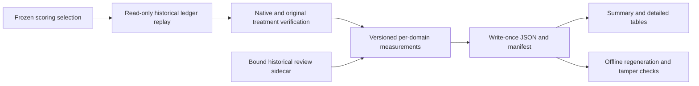

# Offline Evidence Scoring

MP-05 adds `evidence-scoring-v1`, a separate derivative over explicitly pinned historical
sessions. It replays native evidence without launching scanners, target code, Docker commands
or network requests. It does not change old evidence, admissions, rules or execution gates.

## Commands

```powershell
uv run --offline --locked python tools/prepare_scoring_plan.py --session <session-sha256> --rationale "Explain the finite selection" --output workspace/scoring-plan.json
uv run --offline --locked agentsec-evidence score build workspace/scoring-plan.json --output outputs/scoring-example
uv run --offline --locked agentsec-evidence score validate outputs/scoring-example
uv run --offline --locked agentsec-evidence score validate outputs/scoring-example --replay
```

Use a fresh output directory. Validation checks derivative integrity and generated table
consistency. `--replay` additionally reopens the original ledger/native evidence and recalculates
with current analysis bytes. Changed analysis requires a new derivative, not rewriting history.
The preparation helper pins explicitly selected sessions; it does not choose a sample. Its
destination must be a new JSON file in the existing workspace, outside finalized evidence,
review/scoring derivatives and benchmark sessions, including unselected sessions.

Historical replay differs from `benchmark status/run`: those still require current source
bytes to match the execution plan. Scoring opens the existing lock read-only and acquires an
exclusive lock, supported by the pinned Windows/Linux dependencies. It does not create a lock
file, repair history, authorize execution, or claim independent-machine reproducibility.

## Flow



## Measurement Contract

Every row retains session, role, case, attempt, repetition, stage/path/view, state and hash-bound
source references. Each metric inherits the row references and records version, unit, numerator,
denominator, eligibility, exclusions, unknowns and limitations. Empty denominators are undefined;
missing evidence stays null. Failed/refused/unsupported analysis is never a true negative.

| Measurement | Meaning |
|---|---|
| Input decisions | Decisions / full verified inventory; not scanned files |
| Semgrep coverage | Reported selected paths / all selected paths; not proven completion |
| Agent aggregate count | Native count, never a per-file coverage ratio |
| Field retention | Explicit normalized fields preserved in SARIF, not claim correctness |
| Package visibility | Eligible PyPI name/version projections, not completed matching |
| Handoff retention | Left-stage projections retained on right; missing/added identities visible |
| Qualifier losses | Separate from name/version retention and dependency relationships |
| Advisory checks | Approved basic fixture and frozen database; alias-aware package/version pairs |
| Rule/path checks | Original authored eval rule on positive/corrected paths; partial runs unscored |
| Repeatability | Distinct repeats against first semantic projection; retries are not repeats |
| Cost/effort | Retained wall time and recovery events; unmeasured human time stays null |

The field rubric checks rule ID, message, native severity, source blob/pointer, record fingerprint,
source ranges and native suppression when present. Native confidence, description and remediation
are explicitly unrepresented in the current SARIF result projection, but remain in original and
normalized records. Missing native fields are excluded. This is not all-metadata fidelity,
scanner correctness, remediation efficacy or SARIF consumer compatibility. A dubious upstream
CWE can be faithfully preserved while still requiring contextual review.

The dependency oracle remains student-confirmed, AI-authored finite engineering evidence, not
independent adjudication. It is not silently applied to clean/mutated/public cases. Alias closure
changes advisory identity only, never package versions. Unknown-version native advisories are
not exact package-version matches; zero normalized matches is not a safety result. Occurrence,
relationship fidelity and per-package matching completion remain unproven.

## Outputs

- `SUMMARY.md`: generated review entry point.
- `TABLES.md`: every stage/repeat, metric, limit and evidence hash.
- `scores.json`: typed measurements, attempts, reviews and analysis-source hashes.
- `measurements.csv`: one metric per row, with spreadsheet formula-leading text escaped.
- `attempts.csv`: selected failures, interruptions, retries and unattempted cells remain visible.
- `plan.json` and `scoring-manifest.json`: exact selection and derivative integrity.

Optional reviews bind to their original reports and predecessors. AI proposals do not become
accepted labels or automatically transfer to repeated scans. No pooled vulnerability total,
public accuracy, overall risk score or productivity improvement is inferred. Development and
the formative pilot are not held-out data. Evidence remains internal, not release-cleared.

The development-only usefulness rehearsal follows scoring. UI and delivery remain separately
gated; Git publication requires separate instruction.
