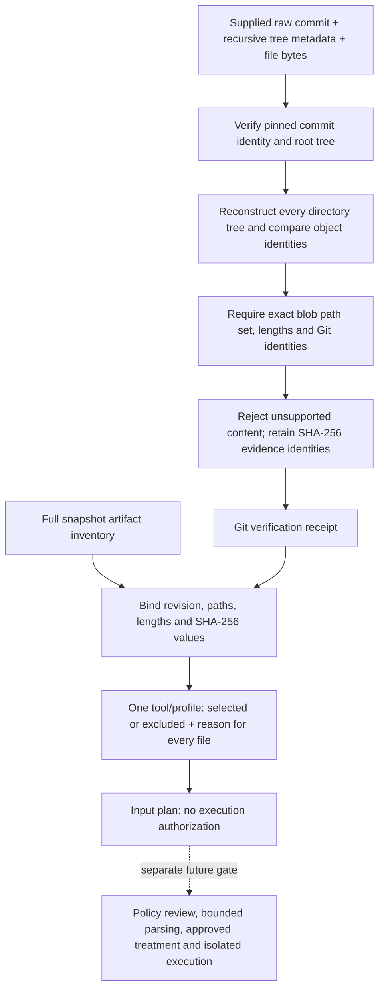

# Pinned Git Verification and Tool Input Plans

## Implemented Boundary

This library increment verifies supplied Git evidence offline, connects it to the existing
full-file artifact inventory, and records a separate selection decision for every file for
one tool/profile. It does not download repositories, launch a scanner, parse target source,
or provide a public-source intake CLI. The only runnable walkthrough uses an authored fixture.

The student confirmed that initial intake must refuse repositories containing symlinks,
submodules or Git LFS pointers. This is a support boundary, not a finding that such repositories
are insecure. Refusal means no verified receipt is returned; it must not become a clean scan.

Later increment: [verified input views](verified-input-views.md) now implements selected-byte
materialization and isolated input validation with full parent policy context for controlled
cases. Statements below about future materialization describe this earlier library increment.
Public acquisition, research treatment admission and scanner execution remain separate gates.



## Evidence Verification

`intake.git_verification.verify_git_source` accepts bytes rather than a working checkout.
The raw commit must hash to the supplied full lowercase, 40-character SHA-1 revision and
begin with one canonical root-tree header. The recursive tree response must explicitly declare
`truncated: false`. Every directory is reconstructed from its immediate children, using Git's
mode/name/object-ID encoding and directory-aware byte ordering. Every supplied file must be
present exactly once, with the declared blob identity and length. Missing or additional files,
line-ending changes and inconsistent tree metadata fail verification.

This follows the [Git object format](https://git-scm.com/book/en/v2/Git-Internals-Git-Objects)
and the entry modes exposed by the [Git trees API](https://docs.github.com/en/rest/git/trees?apiVersion=2022-11-28).
The authored expected object identities were encoded independently using Git, not generated by
the verifier being tested. Metadata API URLs are retained in the raw response hash but do not
participate in Git tree encoding.

The accepted Git modes are regular files `100644`/`100755` and directories `040000`.
Symlinks (`120000`), submodule entries (`160000`) and other modes are unsupported. The library
does not check out executable files or execute their content. Paths must be portable UTF-8
names; absolute/traversal/backslash paths, reserved Windows names, `.git` components and
case-colliding entries are refused. Non-UTF-8 Git paths and SHA-256-format Git repositories
are outside this initial support boundary.

The new Git boundary also applies Python 3.13's `ntpath.isreserved` on both hosts, including
superscript COM/LPT device aliases and spaces before device-name extensions. This follows
[Microsoft's naming rules](https://learn.microsoft.com/en-us/windows/win32/fileio/naming-a-file)
and the [Python Windows-path API](https://docs.python.org/3.13/library/os.path.html#os.path.isreserved).
It is a conservative portability check, not a guarantee of materialization on every filesystem.
The earlier snapshot and artifact contracts are unchanged.

Git LFS stores pointers in Git instead of the large object itself. Content starting with either
the canonical v1 pointer header or its legacy `hawser` header is conservatively refused; this
is not a complete LFS pointer parser. Ordinary text mentioning LFS elsewhere is not refused.
An empty file remains a normal empty blob. No external LFS content is resolved or downloaded.
See the [Git LFS specification](https://github.com/git-lfs/git-lfs/blob/main/docs/spec.md).

| Resource | Current bound |
|---|---|
| Raw commit / recursive tree response | 1 MiB / 4 MiB |
| Recursive entries / regular files | 20,000 / 10,000 |
| Each regular file / total file bytes | 32 MiB / 256 MiB |
| Path length / component depth | 4,096 characters / 64 components |
| Tree JSON structure | Existing strict parser: duplicate-key rejection, depth 64, 100,000 nodes |
| Profile bytes | Nonempty; at most 1 MiB |

The bounds are cumulative constraints, not a promise that all maxima can be reached together.
Callers already hold the supplied bytes in memory: these checks are not a bounded downloader or
filesystem loader. Future acquisition must enforce limits while reading, avoid host checkout
filters/hooks, and preserve the existing isolated parsing and read-only execution rules.

Git SHA-1 is used only for compatibility with the admitted revision format. SHA-256 separately
identifies retained raw metadata and file content. This establishes content consistency under
that Git object model, not remote-origin authentication, signature validation, a collision-proof
Git identity, or validity of every commit header. Those distinctions are explicit in the receipt.

## Versioned Records and Replay

- `git-source-verification-v1`: revision/root tree, raw commit/tree SHA-256 hashes and sorted
  per-file paths, modes, Git blob identities, sizes and SHA-256 hashes.
- `tool-input-plan-v1`: snapshot and inventory identities, verification-receipt identity,
  tool/profile labels, exact profile-bytes hash and sorted per-file decisions with reasons.
- `schemas/repository-input-v1/`: separate JSON Schemas; legacy snapshot, inventory, run and
  reporting schemas are unchanged. Regenerate with `tools/generate_repository_input_schemas.py`.

A schema-valid receipt is still a claim. After loading it, call `replay_git_verification` with
the retained raw commit, tree response and actual file bytes, then bind it to the inventory.
`bind_inventory_to_git` validates metadata correspondence; it does not reread files. The
authored walkthrough replays against the copied snapshot bytes before accepting its plan.
Reordering equivalent API entries preserves Git identities but changes the raw response hash;
the original response must remain available for exact receipt replay.

The original artifact inventory remains a metadata-only derivative. The separate verification
record supplies additional evidence; it does not retroactively upgrade older inventories or
the legacy dependency pilot's archive-validation method. Historical bundles remain unchanged.

## Selection Is Not Admission

`build_tool_input_plan` requires selected paths and an exclusion-reason mapping whose union
is exactly the full inventory. Every entry retains its source SHA-256. Duplicates, overlap,
missing/extraneous paths, blank reasons and mismatched evidence/profile hashes are rejected.
Different tools can therefore have different plans while sharing one full inventory.

Profile bytes are opaque evidence at this stage. Hashing them does not validate tool arguments,
rule eligibility, licensing, upstream defaults or scanner coverage. No runner currently consumes
this plan or materializes a selected filesystem view. All plans explicitly retain:

- `execution_authorization: not-granted`
- `policy_and_suppression_review: not-performed`
- `parser_validation: not-run`

In particular, excluding `.agent-audit.yaml` from selected files does not remove it from the
inventory or bypass the existing mandatory refusal/review policy. The future admission stage
must inspect full repository context before allowing any selected view to reach a scanner.
An authored Python-extension selection can include malformed Python; selection is not parsing.

## Controlled Verification

`test_cases/development/pinned-git/case.json` contains 21 authored files, 32 recursive entries,
the raw commit and tree response, expected Git identities, and an explicit selection profile.
It includes tests, examples, documentation, CI, a policy file, malformed source/configuration,
an executable-bit file, and adjacent `skills.txt`/`skills/` names that test Git tree ordering.
The sample plan selects five Python paths and accounts for 16 exclusions. It is not an approved
research scanner profile or an independently adjudicated security benchmark.

```powershell
uv run python tools/verify_git_input_plan.py `
  --output workspace/pinned-git-walkthrough-01
```

Use a new output directory. The helper refuses overwrite and retains raw inputs, snapshot
bytes, inventory, verification, input plan, summary and SHA-256 manifest. It repeats the
verification/plan construction and replays the serialized receipt. Tests separately exercise
missing/changed/extra files, tree reconstruction, unsupported modes/pointers, metadata ambiguity,
resource bounds, plan coverage, tampering and overwrite refusal. No target code or scanner runs.

This validates intake evidence handling, not vulnerability detection. It adds no findings from
a public repository and does not admit a new public agent-source pilot. Before that next step,
bounded acquisition, per-tool view materialization, full-context policy review, approved profiles
and an explicit case admission must be connected and verified.

### Review and verification, 2 October 2026

The local increment passed 512 tests on Windows and 512 in the existing pinned offline Linux
regression container. Formatting, lint and typing also passed. Five added negative tests first
reproduced Windows-reserved-name acceptance; the Git boundary was corrected, with three benign
near-miss names retained. The final count is 85 tests above the 427-test merged base, not 85
new experiments or security findings. No external dependency or scanner treatment changed.

The repeated controlled walkthrough verifies 21 fixture files against their pinned Git objects
and accounts for five selections plus 16 exclusions. Its verification receipt, input plan and
summary are byte-identical to the earlier walkthrough. No scanner or target code ran. The Linux
regression uses the same host; it does not establish independent-machine reproduction.

This is a locally verified source increment, not a publication/merge receipt or public-pilot
admission. The next connection is bounded acquisition and selected-view handling, preserving
full-context policy checks before any scanner authorization.
