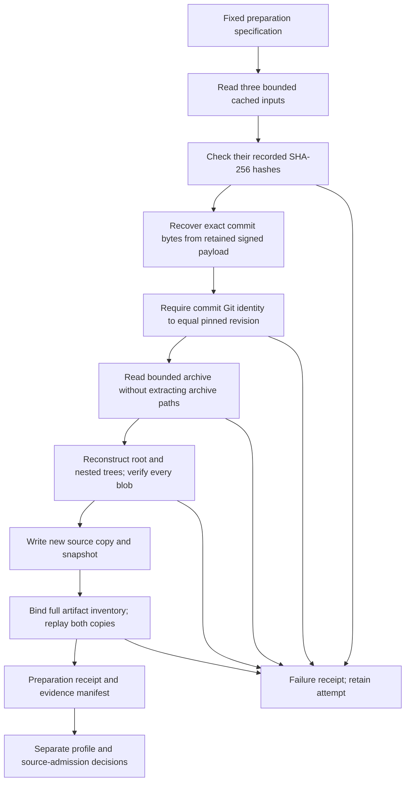

# Pinned Source Preparation

## Purpose and Boundary

This increment connects cached pilot inputs to the complete Git proof and artifact inventory.
It verifies repository content, not vulnerabilities. It does not download, install, import,
build, test or operate the target, run a scanner, or grant source-scanning admission.
The original dependency-only `admission.json`, archive helper and historical receipts stay
unchanged. New preparation evidence is a separately dated derivative, not a retrospective
upgrade of the September dependency experiment.

The fixed candidate remains `langchain-samples/cicd-pipeline-example` at
`5ab0d0a0f3c90999f786f834d9c05484dfe5f2bf`. The preparation specification records the retained
archive, API-response hashes, root tree and expected inventory size. Those counts describe the
previously retained input, not independently reviewed security labels. This candidate is pilot
material and cannot later become held-out evaluation data.

## Invocation Flow



`tools/prepare_source_pilot.py` uses the fixed
`test_cases/pilot/langgraph-cicd/source-preparation.json`. There is no arbitrary public-source
scanner CLI. The underlying library is exercised with authored objects in unit tests.

```powershell
uv run python tools/prepare_source_pilot.py `
  --cache workspace/dependency-pilot-intake-2026-09-18 `
  --output workspace/source-preparation-attempt-01
```

The cache must contain `commit.json`, `tree-exact.json` and `source.zip` with the specified
hashes. The output's parent must already exist; the output itself must not exist or overlap
the cache. Use a new output for every attempt. This command intentionally fails in a checkout
without the private cached evidence; it does not silently fetch replacement bytes.

## What Is Verified

| Layer | Check | Not Established |
|---|---|---|
| Cached inputs | Exact SHA-256 equality with the fixed specification | Fresh retrieval or repository origin authentication |
| Commit | Exact recovered commit object hashes to the pinned Git SHA-1 | Cryptographic signer verification |
| Tree | Complete recursive tree is reconstructed from entries | Historical parent commits or full Git history |
| Files | Every regular blob is present with correct size, Git identity and SHA-256 | Program semantics or runtime behavior |
| Copies | Source and snapshot are independently re-read against the proof | A hostile concurrent host cannot modify files later |
| Inventory | Every verified file is retained, including tests, docs and CI | Filename recognition means detector support |

Git SHA-1 is used only for compatibility with the pinned object identifiers; evidence also
retains SHA-256. Executable mode is verified in the Git tree, but files are never executed and
filesystem executable permissions are not promised by this portable content snapshot.

The cached GitHub commit response contains the exact signature payload and signature. Recovery
supports one LF-terminated PGP `gpgsig` layout and accepts it only when its reconstructed object
matches the pinned revision. It does not synthesize author timestamps from API summaries or
trust the API's `verified` flag. Unsupported/unsigned/missing layouts require separately acquired
raw commit bytes in a future intake path; there is no guessing or network fallback.
See [Git's signature encoding](https://git-scm.com/docs/gitformat-signature) and
[GitHub's commit response fields](https://docs.github.com/en/rest/commits/commits).

## Safety and Failure Accounting

- Maximum ZIP input: 32 MiB; commit response/tree response: 4 MiB each; recovered commit: 1 MiB.
- Maximum expanded files: 10,000, 32 MiB per file, 256 MiB total; bounded entry/path/depth limits
  also apply. Only stored/deflated, unencrypted, single-root ZIPs are supported.
- Reject unsafe/duplicate/case-colliding paths, links, special entries, inconsistent membership,
  unsupported Git modes, submodules and Git LFS pointers. Do not silently omit or resolve them.
- Never use ZIP extraction paths. Verify all supplied content before materializing target files.
- Reject linked/reparse-point ancestors and hard-linked evidence files. Output is a new owned
  directory on a trusted local filesystem; this is not protection against a concurrent hostile
  host administrator. Archive decoding is bounded host-side standard-library I/O, not target
  AST/agent configuration parsing; those still require the isolated validation worker.
- Errors after attempt creation produce `passed: false`, the failing stage, retained available
  raw inputs and an evidence manifest. Failures before safe output creation leave no attempt
  directory. A process kill or storage failure may leave an incomplete directory without a
  final manifest; absence of a successful receipt must never be read as success.
- Accept preparation only with a successful command exit, a successful summary and a verified
  complete evidence manifest. A summary alone cannot establish successful finalization.
- Preparation manifests hash the files that existed before the manifest itself. They are
  integrity inventories, not signatures or tamper-proof storage. Keep their hashes externally
  in the project verification receipt.

## Outputs and Repeatability

An attempt includes the copied specification, original cached bytes, recovered `raw/commit.bin`,
`git-verification.json`, full `source/`, a legacy-format snapshot, `artifact-inventory.json`,
`summary.json` and `evidence-manifest.json`. Common-report commands do not accept this preparation
receipt as a scanner run. A valid inventory still has no finding count or detection outcome.

For same-host repeats, compare preparation summary fields except `prepared_at`, together with
the exact Git proof and source-content identity. Preserve timestamps and original bytes. Do
not claim all files are byte-identical: snapshots include retrieval timestamps, and MIME labels
from the legacy snapshot implementation can vary between operating systems. Git file identities
and proof hashes provide the portable content comparison.

The student confirmed on 5 October that the candidate's Dockerfile remains in the full inventory
but unsupported by the initial KICS profile. Do not add Dockerfile queries, label all YAML as
Kubernetes, or replace this candidate merely because it has no applicable IaC scan. The existing
filename catalog is unchanged; absence of a recognized filename is not absence of an artifact.

## Next Gate

Select and justify separate conventional/extended research profiles, record all-file scanner
input decisions, run isolated syntax and full-parent policy checks, and decide source-pilot
admission. Only then connect the applicable treatments into sequential same-repository runs,
repeats and a comparison table. No new detector, paid access or target runtime is required here.
