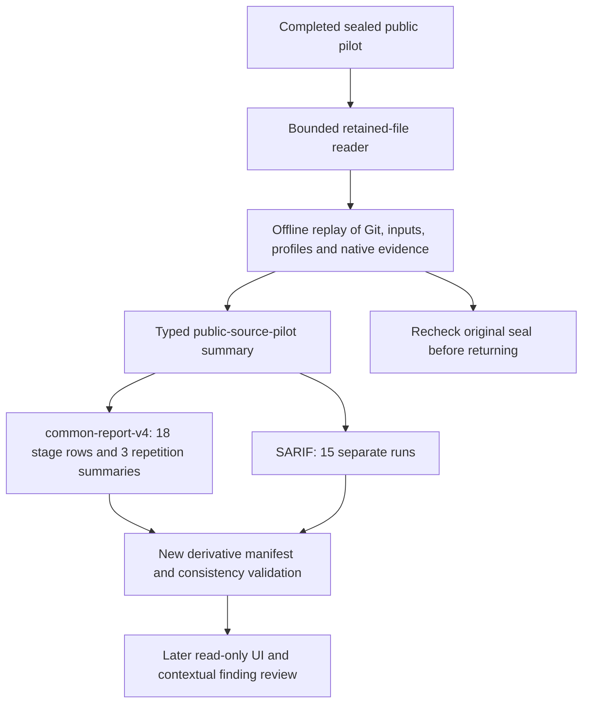

# Public Pilot Common Reporting

## Scope

The 7 October 2026 increment adds an offline read model for the completed, sealed
[same-repository pilot](same-repository-pilot.md). It does not run scanners, acquire source,
change profiles, refresh vulnerability data, or authorize another target. Original pilot
files, including the failed attempt, remain unchanged. This is formative integration
evidence, not a held-out evaluation or a claim of comprehensive agent security analysis.

The fixed input is `langchain-samples/cicd-pipeline-example` at
`5ab0d0a0f3c90999f786f834d9c05484dfe5f2bf`: 47 inventoried source files, 26 selected Python
files, three repetitions and six stage rows per repetition. The loader replays the original
pilot admission and evidence before constructing a new derivative.

## Flow



All input evidence is read-only. The only writes are to a new output directory outside
finalized bundles. A failed or incomplete attempt is not silently promoted to a completed
pilot. A source and its nested or copied constituent runs cannot both be counted in one
common report.

## Commands

From the development repository, with retained pilot evidence already available:

```powershell
uv run agentsec-evidence report build <completed-pilot-directory> --output <new-report-directory>
uv run agentsec-evidence report validate <report-directory>
uv run python tools/verify_public_pilot_reporting.py <completed-pilot-directory> --output <new-verification-directory>
```

The verification helper builds twice, compares semantic report content and exact SARIF
bytes, tests four altered derivative copies, and checks that the original evidence seal
has not changed. It does not invoke Docker or execute a target. Private native evidence
is not included in the source checkout; the automated test suite uses explicitly synthetic
read-model cases instead of redistributing the public target or scanner reports.

## Contracts and Counting

| Output | Meaning |
|---|---|
| `report.json`, `common-report-v4` | Common report containing a `public-source-pilot` source |
| `public-source-pilot-summary-v1` | Frozen plan metadata, full inventory, source selections, 18 stage rows, three repetition summaries and evidence references |
| `results.sarif` | Five scanner runs per repetition, preserving policy views and dependency paths separately |
| `report-manifest.json` | Derivative byte hashes and original source-manifest identity |

Each repetition exports Semgrep research, Semgrep repository-policy, Agent Audit, direct
OSV and SBOM-mediated OSV runs. Syft remains an inventory stage in the table, not a fabricated
vulnerability scanner run. Three repetitions therefore yield **18 rows and 15 SARIF runs**.
Older source combinations retain common-report-v1/v2/v3; original bundle contracts are not
rewritten. The generated schema remains under the historical `schemas/reporting-v1/` path.

The read-model plan stores metadata and is not an execution authorization. The actual
public loader still enforces the existing fixed `PilotPlan`; accepting synthetic metadata
in a unit test does not admit a new repository to the scanner.

## Evidence Preserved

- Both Semgrep views retain native findings, suppressions, process assessments and per-file
  observations. Implicit `.gitignore` filtering remains disabled in both views.
- Native directory-skip context remains separate from individual file observations. A
  skipped directory does not invent a native per-file skip or analysis-completion record.
- Agent Audit retains every original finding/run/execution identity, location and native
  link. Its eight reports per repetition remain **unreviewed reports**, not eight confirmed
  vulnerabilities. The aggregate 21-file producer count does not establish which of the
  26 selected files completed analysis.
- Dependency paths retain separate identities, matches, unsupported states and reported
  representation losses. Package counts use the established PyPI name/version projection,
  not an assertion that all source qualifiers or dependency relationships survived.
- Timing, coverage and intervention fields preserve collection declarations. They do not
  measure unrecorded preparation or adjudication effort; that duration remains null.
- Native artifact paths, hashes and pointers remain linked to the original sealed bundle.
  New SARIF run bindings cover the entire exported run, including messages and locations,
  rather than validating counts alone.

There is no combined vulnerability total, invented risk score or cross-repetition finding
deduplication. Dockerfile remains present but unsupported; LangGraph configuration is not
relabeled as MCP. Wider prompt, skill, memory and runtime analysis is not implied.

## Verification Boundary

`report build` verifies the source seal and replays original evidence. Standalone
`report validate` checks the derivative's schema, hashes, identities, counts and SARIF
bindings; it does **not** reopen original bundles. Checksums establish consistency, not
external attestation. A coordinated rewrite of both a derivative and its manifest is not
an independently authenticated research record.

The retained reader permits only the known empty dependency runtime directories left by
the sealed pilot (`runtime`, `home`, `tmp`, `docker-config`). This compatibility allowance
does not allow unmanifested files, arbitrary directories or links. Controlled research
readers retain their existing manifest contract and checks.

The 13 October review tightened derivative consistency checks: repetitions must retain
distinct run/execution identities, each dependency summary must use the plan's frozen
database, and required dependency stages must be present without duplicates. Invalid
stage lists produce a validation error rather than an uncaught iterator exception. These
checks do not change original results or make report validation an independent attestation.

This increment does not complete contextual finding adjudication, general benchmark
resume/freeze governance, the read-only UI, independent-machine reproduction, consumer
SARIF upload testing or public-release clearance. Preserve those as separate milestones.
