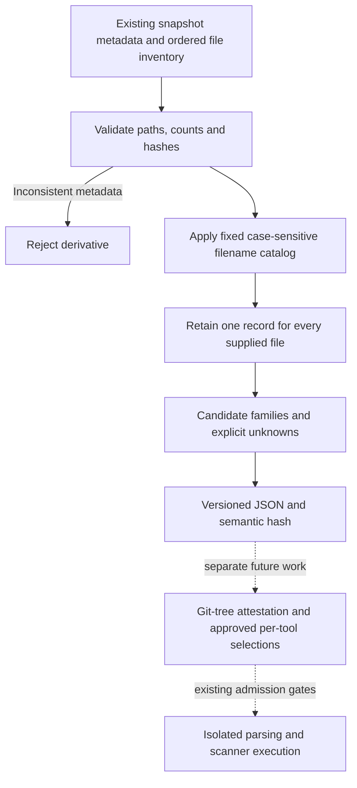

# Repository artifact inventory

## Implemented boundary

The first inventory increment is a **metadata-only library and authored verification tool**.
It consumes an existing `TargetSnapshot` plus its ordered `InventoryEntry` records. It does
not acquire a repository, read its content, execute a scanner, parse prompts/configurations,
resolve imports or grant permission to run a tool. No application CLI intake command is added.

Full pinned-revision inventory is the working direction: retain tests, examples, documentation
and CI before selecting each scanner's inputs separately. This implementation preserves every
**supplied** snapshot entry, including unrecognized files. It cannot prove that the upstream
snapshot acquired every tracked Git object. Git-tree verification and source-pilot admission
remain separate work; the existing public pilot is still approved for dependencies only.

## Invocation flow



The solid path is implemented by `agents.inventory.build_artifact_inventory`; the dashed
path is not invoked by this library or verification helper. Existing bounded scanner commands
remain unchanged.

## Recognition catalog

`agents.artifact_catalog` fixes `artifact-path-candidates-v1`, each recognizer's version,
reference, retrieval date and limitation. Matching uses literal, case-sensitive basenames or
suffixes at any directory depth. It does not use target-local exclusions, `.gitignore`, MIME
labels, guessed names such as `memory.json`, or keyword searches. The embedded catalog and its
SHA-256 identify the exact rules; a changed catalog requires a new versioned treatment/contract.

| Candidate family | Current convention | What is not established |
|---|---|---|
| Python source | `.py` | Valid syntax, a registered agent tool, bindings or data flow |
| Agent configuration | `langgraph.json` | Schema validity, framework support or deployment use |
| MCP configuration | `claude_desktop_config.json`; project fixture name `mcp.json` | Valid `mcpServers`, protocol-wide naming or effective access |
| Instructions | `AGENTS.md` | Prompt safety, instruction priority or actual consumption |
| Skills | `SKILL.md` | Required frontmatter, trust, permissions or executable behavior |
| Dependencies | `uv.lock` | Package inventory or completed vulnerability matching |
| IaC | `.tf`, `.tf.json` | Valid configuration, module graph or deployed controls |
| Memory/context | No recognizer yet | Presence or absence: count remains null |
| Identity/permissions | No recognizer yet | Presence or absence: count remains null |

Seven primary documentation references were checked on 2 October 2026. They establish naming
conventions, not the accuracy of this recognizer or security of the named artifact:

- [Python modules](https://docs.python.org/3.13/tutorial/modules.html): Python source filenames.
- [LangGraph CLI](https://docs.langchain.com/langsmith/cli): default configuration filename.
- [MCP local-server guide](https://modelcontextprotocol.io/docs/2026-07-28/develop/connect-local-servers): Claude Desktop client example, not a universal protocol filename.
- [AGENTS.md](https://agents.md/): root/nested instruction-file convention.
- [Agent Skills specification](https://agentskills.io/specification): skill-file convention; frontmatter validation is not implemented here.
- [uv project structure](https://docs.astral.sh/uv/concepts/projects/layout/): uv lockfile convention.
- [Terraform configuration files](https://developer.hashicorp.com/terraform/language/files): HCL and JSON filename suffixes.

`mcp.json` is explicitly a [project case convention](agent-artifact-contracts.md), not an
additional external standard. A generic YAML file is not automatically classified as Kubernetes;
custom prompt names and other ecosystem lockfiles remain retained but unclassified. A file
with a recognized name and malformed content is still only a candidate.

## Evidence and accounting

The separate `artifact-inventory-v1` contract and `schemas/artifact-inventory-v1` leave existing
snapshot, finding, agent-v1, SARIF and common-report contracts unchanged. Each record preserves
the original path, SHA-256, byte count and media-type metadata and links its candidate rule IDs
to the catalog. Its artifact ID binds snapshot identity, source path/hash and catalog hash.

- Every record has `parse_state=not-run`, `analysis_state=not-run`, `finding_count=null`.
- Family counts measure **candidate files**, not findings, rules, packages or confirmed artifacts.
- Zero means no filename candidate recognized by this limited catalog, not no such feature.
- Unsupported recognition has a null count and `unknown` interpretation, not a fabricated zero.
- Multiple rule matches on a file would count that file once per family; family totals are not
  necessarily additive. Files without matches remain explicit records.
- Snapshot counts, inventory serialization hash and metadata-derived content identity must agree.
  The original inventory order is preserved; it is not sorted into a new snapshot identity.
- Duplicate/case-colliding and nonportable paths are rejected. The limit is 10,000 file entries.
  Git-labelled metadata requires a full lowercase revision hash, but no Git object is fetched.
- `repository_completeness=not-verified`, `content_reverification=not-performed` and
  `scan_authorization=not-granted` remain mandatory. Self-consistent metadata is not authentic
  evidence by itself. A later intake step must establish its connection to the pinned Git tree.

Pydantic validation reconstructs expected candidates and family accounting and rejects altered
derivatives. JSON Schema validates structure only; it cannot perform these cross-field hash and
recognition checks. Nested legacy models remain mutable, so revalidate serialized reports before
using them; the semantic-hash helper does this automatically.

`artifact-inventory-semantic-v1` excludes only snapshot `retrieved_at`. Everything else, including
original hashes, media-type metadata, revision, catalog and unknown states, stays in the projection.
It compares identical supplied metadata, not independently reacquired snapshots whose metadata
may differ across systems. Raw reports must also be retained.

## Authored verification

From the development repository with the locked environment installed:

```powershell
uv run python tools/verify_artifact_inventory.py --output workspace/artifact-inventory-check-01
```

Use a new output directory for each attempt. The helper refuses an existing directory. It creates
only the registered authored case, snapshots its files without executing them, writes two inventory
reports, compares them with explicit fixture expectations, revalidates serialization, and writes a
summary plus SHA-256 manifest. It neither contacts external services nor accepts a target repository.

The case has 19 files: 13 receive filename candidates and six remain unclassified. It deliberately
includes malformed Python/JSON, a skill without frontmatter, an execution-raising Python body and
files in tests/examples/docs/CI. Their contents do not influence recognition. Memory and identity
counts remain null. These are AI-authored engineering expectations, not independently reviewed
labels, precision/recall measurements or a new public pilot.

Regenerate the schema with `uv run python tools/generate_artifact_inventory_schema.py`. Run the
focused tests plus the full regression suite before publication. All generated evidence belongs
under ignored `workspace/` or `outputs/`; no raw targets or output reports enter Git by default.

## Next integration gates

1. Review this increment and the candidate limitations; do not call the inventory a detector.
2. Verify complete pinned Git-tree intake and define versioned per-tool input selections, including
   explicit exclusions and existing policy/suppression guards.
3. Select separate research profiles rather than repurposing the narrow Semgrep/KICS fixture rules.
4. Obtain new source-pilot admission before any public agent-source scan. Later connect validated
   inventories and execution coverage to reporting/UI without converting unknowns into clean results.

Adding source modules changes the existing whole-source worker identity for future agent runs.
Do not rewrite old run hashes or reuse them as if generated by the new source tree. This increment
does not change the scanner images, tool pins, dependency lock or old semantic projections.
