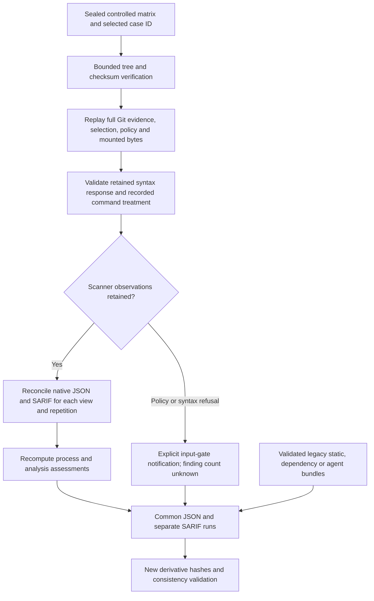

# Retained Research Evidence in Common Reporting

Status: offline reporting of sealed, controlled Semgrep research cases. This adds no scanner
command, public-source admission, final profile freeze or target execution. The original
[guarded runner](guarded-research-runner.md) and its evidence remain unchanged.

## Data Flow



These are reads and deterministic transformations of retained evidence. No Docker invocation,
Python AST parsing, target import, dependency installation, model call or network access occurs
in this reporting path. Replaying a syntax *response* does not rerun the syntax worker.

## Commands and Inputs

The input is one case directory directly below the complete sealed matrix, not a source-code
directory or an arbitrary native report. Use multiple case directories to combine observations.
The entire original matrix must remain available, including its exact profile, rule/license
bytes, registry, Git objects, source/view copies, worker evidence and native reports.

```powershell
uv run --frozen --offline agentsec-evidence report build `
  workspace/<sealed-matrix>/<case-id> `
  --output workspace/<new-report>
uv run --frozen --offline agentsec-evidence report validate workspace/<new-report>
```

Existing static, dependency and agent bundle paths can also be passed to the same `report build`
command. Outputs must be new and outside finalized evidence/report trees. Duplicate sources and
overwrites are refused. This does not extend `scan`, `inspect` or `normalize` to research cases.

## Additive Contract

| Source combination | Common contract | SARIF accounting |
|---|---|---|
| Legacy static/dependency only | `common-report-v1` | Existing one/static and two/dependency runs |
| Agent present, no research | `common-report-v2` | Existing agent behavior |
| Any `semgrep-research` source | `common-report-v3` | Separate run per research view/repetition, plus legacy runs |
| Refused research case | v3, `semgrep-research-summary-v1` | One explicitly synthetic input-gate notification, not a scanner invocation |

The generated common schema stays in its historical `schemas/reporting-v1/` directory and
accepts all three contracts. Original bundle, normalization and semantic-hash versions are
unchanged. A research source ID binds the full matrix manifest hash and case ID; it is not a
new claim of cross-run semantic identity. Its source semantic hash remains null.

Each research summary retains the selected-file denominator, policy and blockers, scope,
syntax state, pass keys/repetitions, native file observations, suppressions, process assessment,
exit code, duration and both native report locators/hashes. Dual views retain their reconciliation
rather than collapse it into an alert total. The summary's `observed` state means scanner
evidence exists, not that every rule completed or every file is safe.

- `native_finding_records` is per pass, including native suppressed records where retained.
- Repetitions and research/policy views are not additive vulnerabilities. `vulnerability_total`
  remains null. There is no aggregate score or cross-tool deduplication in this increment.
- Refused cases have no passes. `unrun_finding_count` remains null, never zero. The synthetic
  SARIF run has empty results only because no scanner observations exist; its invocation is
  unsuccessful and its properties explicitly say `scannerLaunched: false`.
- Native exit 2, file exclusions and reconciled native issues remain incomplete. Complete
  rule-by-file coverage stays `not-established`, even when process exit is zero.
- Process duration is the recorded wrapper lifetime, not report-generation time or analyzer
  CPU time. Rebuilding a report does not create a new benchmark measurement.

## SARIF and Evidence Meaning

Original native JSON/SARIF bytes are untouched. Each exported research result uses a portable,
percent-encoded source-relative URI, its native region/message/rule data, `kind: review` and a
target/profile/anchor fingerprint. Available native column encoding is preserved. Source run,
matrix hash, case, pass, native report paths, SHA-256s and JSON pointers make the copy traceable.

Native suppression metadata stays in the summary and result properties. An exported SARIF
suppression is marked `underReview`, never interpreted as this platform's approval. Findings
omitted by native JSON but retained in native SARIF keep a null JSON pointer. Native severity
and rule mappings are upstream assertions, not independently adjudicated vulnerability labels.

Each actual pass keeps its native invocation status and exit code separately. The exported
invocation is unsuccessful for failed execution or nonzero native exit; a warning explains
that complete analysis is not established. Policy effects do not become proof of remediation.

## Verification Boundary

`report build` verifies manifest membership/hashes, refuses links/reparse points/hardlinks,
and replays selected-case Git, input, policy, paired native and process-derived records. It
checks recorded argument arrays against the guarded builders. Only the Docker executable's
host path and bind-mount host source paths are abstracted for evidence relocation; destination
paths, readonly flags, network/resource treatment and other arguments must still agree.
This is consistency verification, not proof that a historical command actually ran, origin
authentication or a substitute for a trusted evidence custodian.

The retained-tree limits are 4,096 files, 16 MiB/file, 128 MiB total and 64 path components;
manifest size is at most 4 MiB. Native JSON/SARIF keep their stricter 4 MiB limits. The runner's
top-level `runtime` scratch is outside its seal and ignored; it supplies no reporting evidence.
Unknown or unmanifested files elsewhere are refused.

`report validate` checks the new derivative's hashes, schema, source links, pass counts,
anchors, fingerprints, suppression meaning and execution accounting. It does **not** reopen
original sources or independently revalidate every copied upstream field. Retain the originals
and rebuild to revalidate them. A coordinated rewrite of evidence plus its hashes is not
detectable without a separately trusted seal; no signatures or external attestation are claimed.

Interrupted/unsealed matrices, failed syntax-worker captures, missing/malformed native pairs,
extra/missing passes and changed derivatives are refused, not converted to clean reports.
General reporting for arbitrary failed attempts remains future work; preserve those attempts
in the original execution workspace. Refusal before a scanner runs *is* represented when it
is a fully retained policy/syntax outcome. Sealed valid native pairs may carry incomplete or
failed execution assessments; reporting does not upgrade them to success.

## Engineering Verification

```powershell
uv run --frozen --offline python tools/verify_research_reporting.py `
  --matrix workspace/<sealed-controlled-matrix> `
  --output workspace/<new-report-verification> `
  --legacy-bundle workspace/<existing-legacy-bundle>
```

The helper builds and validates each case, combines all supplied sources, compares repeated
SARIF bytes, and checks that original evidence is unchanged. It executes zero scanners. Tests
also use synthetic native evidence to exercise corruption/refusal cases; those are engineering
assertions, not new scanner measurements. Mixing targets demonstrates report compatibility,
not same-repository execution, detection accuracy, a held-out study or SARIF consumer support.

Private matrices and upstream rule/native bytes are not distributed in Git. A clean checkout
can run synthetic regressions, but cannot replay a private matrix it does not possess. Licensing,
redaction, public distribution and independent-machine reproduction remain separate gates.
