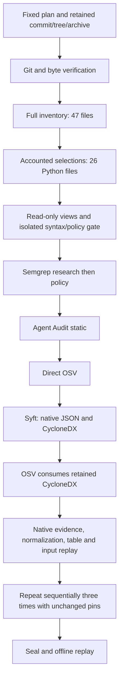

# Bounded Same-Repository Pilot

## Purpose and Approval

The student approved this finite formative pilot on 6 October 2026. It measures whether
the existing pipeline can produce reproducible, evidence-linked observations and explain
coverage limits on one public repository. It does not establish detection accuracy,
exploitability, general agent security, or independent expected outcomes.

The fixed plan is `test_cases/pilot/langgraph-cicd/source-pilot.json`. Existing controlled
fixtures and the original dependency admission remain unchanged. The broader 68-rule
profile retains its candidate status; approval here is specific to this pilot, not general
admission or a confirmatory benchmark freeze. Repository selection preceded these results.

## Frozen Treatment

- Repository: `langchain-samples/cicd-pipeline-example`.
- Revision: `5ab0d0a0f3c90999f786f834d9c05484dfe5f2bf`; verify all 47 regular files against Git.
- Source selection: all 26 Python files, including tests, examples and CI scripts.
- Semgrep: unchanged pinned 68 GitLab Python rules; research and repository-policy views.
  Both disable implicit Git filtering. Policy means native ignore files and inline
  suppressions, not the repository's complete CI policy. Suppressions are not approvals.
- Agent Audit: existing pinned static analyzer, severity info and above, same 26 files.
  Input validation is not proof of LangGraph-specific detection or per-file completion.
- Dependency treatment: lockfile-wide PyPI inventory, 159 eligible name/version identities;
  editable root separately. Direct OSV and Syft native JSON/CycloneDX -> OSV use the same
  existing database and configuration. No reachability analysis or target installation.
- Dockerfile: observed but unsupported; no KICS run. `langgraph.json` is not MCP evidence.
- Prompts, memory, skills, permissions, agent communications and runtime behavior have no
  dedicated treatment here. Inventory observations must not become coverage claims.

## Invocation Flow



The conventional view consists of conventional source/dependency observations, with IaC
explicitly unsupported. The extended view reuses them and adds Agent Audit. The two OSV
paths and two Semgrep views are paired treatments, not independent vulnerabilities to sum.

## Safety and Failure Rules

Pinned local containers only; no automatic pulls. Network denied, target read-only, no
Docker socket or user home, one scanner at a time. Source containers are non-root with
CPU, memory, process and output limits. Dependency containers retain their established
limits (including their existing swap behavior); this pilot does not silently change them.
Only trusted scanner/validation software runs. No target imports, installation, builds,
tests or live agents. Untrusted Python is parsed only in the isolated syntax worker.

The runner refuses changed inputs/configuration, unsafe intake, policy blocks or malformed
evidence. It retains failures and unrun rows. No automatic retry or resume: a corrected
instrument attempt has a new directory and documented reason. Production benchmark
resume semantics remain separate work. Existing outputs are never overwritten.

## Measurements and Limits

Three fresh sequential repetitions preserve stage exit/status, native outputs, findings,
package identities, stage time, repetition wall time, and required manual recovery.
Preparation/image inspection is outside repetition wall time. Replay guards and host
normalization are inside it. Host caching is uncontrolled; these are descriptive timings.
Dependency summaries separately retain direct, initial SBOM and reused-SBOM path timing.
Manual preparation/adjudication time is unknown, not zero. Automatic execution does not
demonstrate that no analyst review is needed.

In the pilot rows, `package_identities` counts the declared PyPI name/version projection,
including the separately reported local root. It does not count fully source-qualified
identities. Use "name/version pairs" in presentations and keep the eligible denominator
and source-qualifier losses alongside that count.

Semantic repeatability excludes only declared volatile fields: Semgrep execution ID/raw
output hashes; Agent Audit scan/detection timestamps; dependency-semantic-v2 raw hashes
and known unordered collections. Native bytes are retained. No arbitrary sorting of agent
findings or selective exclusion to manufacture equality. Dependency per-stage hashes use
the existing v2 projection restricted to that stage and the unchanged dependency scope.

Findings are producer reports, not adjudicated vulnerabilities. Missing observations stay
null, not zero. Agent per-file completion and OSV per-package matching completion remain
unknown. Package projections do not prove occurrence or relationship preservation. Native
severity/confidence and CWE mappings are retained as assertions, not established truth.

The new `same-repository-pilot-report-v1` envelope links all stages. Dependency constituents
also use established common-report-v1. Public source results are not falsely imported as
controlled development cases into common-report-v3. General public-source common reporting,
UI, held-out evaluation and independent-machine reproduction remain separate milestones.

## Local Execution

The first local attempt exposed directory-level native policy skips. Its failure and raw
reports are retained. The pilot explicitly accepts canonical ancestor paths of selected
files for known native ignore reasons; foreign, duplicate or contradictory records still
fail. `directory-skips.json` preserves native pointers and selected descendants. Children
not individually reported remain `unreported`, not fabricated native per-file exclusions.
This sidecar participates in the pilot semantic hash. Legacy reconciler calls retain the
strict default, so earlier derivative bytes and contracts do not change. This correction
does not alter rules, target selection, versions or scanner policy.

Prepare the already pinned images, approved cached repository evidence, rule files and
frozen database first. None is downloaded by this helper or distributed in this checkout.

```powershell
.venv/Scripts/python.exe -X utf8 tools/run_source_pilot.py `
  --cache workspace/dependency-pilot-intake-2026-09-18 `
  --rule-source workspace/phase3-semgrep-broad-assessment-2026-10-05/upstream-full-01/source `
  --database workspace/dependency-preflight-2026-09-18/database/osv-scanner/PyPI/all.zip `
  --output workspace/phase3-source-pilot-2026-10-06/pilot-01
```

Use a fresh output child. `pilot-report.json`, `comparison.csv`, per-tool native evidence,
normalized Agent Audit JSONL/SARIF, dependency bundles, frozen inputs and the SHA-256 manifest
are private execution artifacts. Hash/replay checks show internal consistency, not external
attestation. Publish only reviewed derivatives; avoid disclosing untriaged third-party issues.
