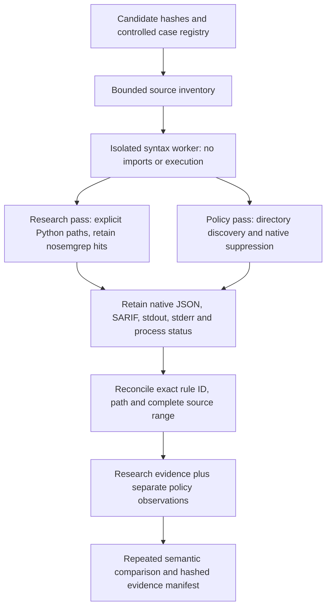

# Semgrep Research Evidence Contracts

Status: first library/controlled-verification increment, 5 October 2026. The student approved
all 68 pinned GitLab Python rules as a **development candidate** and separate research/policy
views. This is not the frozen public-pilot profile, a new public scan command, or a detector
accuracy claim. Existing Semgrep, KICS, dependency and Agent Audit contracts remain unchanged.

## What This Adds

- `configs/research/semgrep-python-candidate-v1.json`: exact source paths, rule IDs and SHA-256
  hashes for all 68 candidate rules; upstream license hash; tool and source pins; limitations.
- `research.models`: separately versioned profile, scope, pass-evidence and dual-view records.
- `research.semgrep`: bounded, strict native JSON/SARIF reconciliation and derived policy view.
- `schemas/semgrep-research-v1`: matching JSON Schemas, not replacements for legacy schemas.
- `test_cases/development/semgrep-research/cases.json`: 30 source-condition cases and a policy
  scenario with ten Python files and two ignore files. These are authored development material,
  never held-out cases or independently adjudicated vulnerabilities.
- `tools/verify_research_semgrep.py`: offline verification of those registered cases only.
  It does not accept a target repository. The CLI/report-build path does not yet consume these
  derivatives; common-report and existing SARIF-export contracts have not changed.

## Exact Candidate

| Item | Pin / Interpretation |
|---|---|
| Rule source | `https://gitlab.com/gitlab-org/security-products/sast-rules` |
| Source revision | `53bf5cf6df3c51b6c02110f5a638b5e6213666cd` |
| Inventory | All 68 Python YAML rules; not comprehensive Python or agent-security coverage |
| Semgrep | `1.174.0`, pinned image digest in the candidate manifest |
| Rules license | MIT notice, exact upstream LICENSE hash in the manifest |
| Prior upstream checks | 64 active annotation tests passed; four examples had no active assertions |
| Distribution | Rule bytes and third-party examples are not bundled in this increment |

The upstream annotation checks test implementation compatibility, not real-world accuracy.
Third-party examples can have notices different from the rule files; the rule license must not
be applied automatically to those examples. `verify_rule_bytes` checks every supplied rule and
the license against the candidate; it does not authenticate upstream authorship.

## Implemented Flow



Both controlled passes use the unchanged 68-rule pack. The research pass supplies every selected
path explicitly and uses `--disable-nosem`; SARIF still retains native suppression metadata.
The policy pass scans the controlled parent directory with its original ignore files. Both use
`--no-git-ignore`, `--strict`, `--verbose` and paired native JSON/SARIF. This controlled policy
treatment is **not** a reconstruction of arbitrary project CI, all Git policies or remote policy
includes. General policy resolution is still a prerequisite for public execution.

Explicit targets bypassed tested scanner ignore/size filtering in the prior assessment.
Consequently, platform limits precede the scan: at most 64 combined source/policy files,
256 KiB per file and 1 MiB total input. Native reports are bounded to 4 MiB each. The syntax
worker checks actual bytes against the inventory; source code is parsed only inside that worker.

## Evidence Semantics

| Observation | Representation | What It Does Not Mean |
|---|---|---|
| Listed as scanned | File `reported` | Every rule completed or all weaknesses were examined |
| Scanned and a native issue also listed | `reported-with-native-issue`, original reason retained | Complete analysis |
| Native ignore reason | File `native-skipped`; finding policy view `file-excluded` | Safe, fixed or not applicable |
| Size/internal/unknown skip | Native reason retained; missing finding policy state `unknown` | A repository-approved exclusion |
| Missing file observation | File `unreported` | Zero findings from a successful scan |
| SARIF suppression | `native-suppression-marked`, entire suppression record retained | Researcher or reviewer acceptance |
| No policy run | Policy view `not-run`, finding observations `unknown` | Zero policy findings |
| Finding missing on a reported policy file | `not-observed`, or `unknown` when errors/notifications exist | Remediation or proven false positive |

Suppressions retain native `kind`, optional `status`, justification and other fields. Missing
status is not filled in as accepted. Every derivative finding has `review_state: unreviewed`.
A native rejected suppression remains rejected native metadata, not an accepted project waiver.

Reconciliation requires exact rule ID, canonical relative path and complete line/column range;
matching line alone is insufficient. It also checks native messages, declared rule membership,
versions, path accounting, duplicate anchors and cross-pass identity. A suppressed SARIF-only
finding is allowed in the policy pass; unexplained JSON/SARIF discrepancies are errors. No
fingerprint is invented from Semgrep's `requires login` placeholder. Original reports remain
authoritative evidence, addressed by hashes and JSON pointers.

Declared SARIF rules are recorded, but declaration does not prove each rule ran on each file.
The tested ASCII cases use matching native coordinates; absent SARIF `columnKind` is tolerated
for this pinned producer. A different column convention is refused, not silently converted.
`vulnerability_total` stays null and `analysis_completeness` stays `not-established`.

These models check consistency, not source authenticity or subprocess success. A loaded
derivative must be replayed through `reconcile_semgrep_pass` against the retained native bytes,
profile and scope before it is trusted. A scope's selection hash is not Git-tree attestation;
the existing intake proof and input-plan bridge must be connected by the future runner.

## Verification Observed

The completed controlled attempt ran two syntax workers and six sequential scanner invocations:
two repetitions each of the condition, research-policy and repository-policy treatments.
Normalized observations repeated exactly; only execution IDs and native-byte hashes are excluded
from that comparison. Original bytes are retained even when runtime/timing metadata differ.

| Treatment | Selected Python Files | Native Findings Per Repeat | Native Exit / Limitation |
|---|---:|---:|---|
| Additional condition cases | 30 | 14 | 0; not an accuracy or complete-analysis claim |
| Policy scenario, research view | 10 | 9 in JSON and SARIF | 2; intentional unmatched suppression warning |
| Policy scenario, repository-policy view | 10 | 4 in JSON, 7 in SARIF | 2; same warning, two native file exclusions |

The nine research findings map to **four reported, three native-suppression-marked and two
file-excluded** observations. These are views of the same evidence, not quantities to sum.
The unmatched-rule case remains a finding on a file with a native issue. Semgrep's friendly
"completed" message did not override its exit code or structured warning.

The 30 source-condition cases retain five disagreements with the designated-rule observation:
an unrelated `popen` method, non-security visual randomness, a test assertion and a non-security
checksum are reported; the `xml.sax.expatreader` API example is not. The last rule's inspected
pattern refers to `xml.dom.expatreader`, while its message names `xml.sax.expatreader`. None
of these observations was hidden by editing upstream rules or relabeling test inputs. Contextual
API advisories must not be reported as confirmed exploitation. Earlier YAML, archive, generic
shell and TLS-wording limitations also remain open in the candidate manifest/planning record.

Final application checks: **663 tests passed on Windows and 663 in the pinned offline Linux
verifier**, including 59 new unit/contract tests. Windows formatting, lint, strict typing and
installed dependency consistency passed. No package, lockfile, scanner version or legacy fixture
profile was changed. No public repository or target code was executed.

## Reproduction

Use the existing locked development environment and locally prepared pinned images. Obtain the
exact rule source under the repository's source/license preparation process; this helper never
downloads or substitutes missing rules. Private raw evidence is intentionally absent from Git.

```powershell
uv run --frozen --offline python tools/generate_research_schemas.py
uv run --frozen --offline python tools/verify_research_semgrep.py `
  --rule-source <cached-upstream-root> `
  --output workspace/research-check-new
```

The output directory must be fresh and under `workspace/`. Containers use no network, read-only
targets/root, an unprivileged user, dropped capabilities, no-new-privileges, 2 CPUs, 2 GiB memory,
256 PIDs, bounded output and a 120-second deadline. Temporary scanner storage is noexec. Neither
target dependencies nor project tests are installed/executed. The separate Linux application
regression uses executable temporary storage for trusted test subprocesses, not target code.

The helper verifies the intentionally incomplete warning scenario rather than treating every
nonzero exit as a generic failure. Only the registered policy group permits exit 2, and its
specific native warning is checked. Unexpected errors, resource limits or cleanup failures stop
verification with retained evidence. Earlier failed helper attempts are retained in the private
implementation receipt; they are not counted as completed repetitions.

## Next Increment

1. Connect full-parent Git evidence and selected views to a separate research runner.
2. Validate policy include resolution, unsupported constructs, absent outputs, malformed source,
   conflicting native reports and bounds before public admission. Do not inherit policy assumptions
   from these small controlled cases.
3. Carry process status, syntax results and partial native coverage into normalized/common reporting.
4. Freeze the actual public treatment with the documented rule limitations; keep conventional
   analysis identical when comparing the conventional and extended toolchains.
5. Admit and repeat the same pinned public source pilot only after those gates pass.

The broad agent-security coverage map, Dockerfile unsupported boundary and existing Agent Audit
refusal policy are unchanged. This work does not complete the 60-point build checkpoint.
