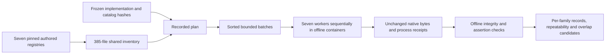

# Shared Custom-Family Validation

## Scope

This is a development-only validation instrument, not the public-repository scanner.
It reuses the seven unchanged repair registries (385 cases, 16,246 UTF-8 source bytes)
and applies every repaired family to the same union of Python inputs. It neither
imports nor executes target code. Public candidate admission, baseline comparisons,
the new common-report adapter and HTML integration remain separate gates.

Existing family workers, catalogs, source registries and historical evidence are
unchanged. Registry SHA-256 pins are in `custom_rules/shared_inputs.py`. Each attempt
also records the entire Python implementation snapshot, catalog digests, validator
image ID, requests, selected files and execution limits before launching workers.

## Invocation

From the development root, using its locked Python environment:

```powershell
.venv\Scripts\python.exe -X utf8 -m agentsec_evidence.custom_rules.shared_execution preview
.venv\Scripts\python.exe -X utf8 -m agentsec_evidence.custom_rules.shared_execution run --output workspace/shared-custom-attempt-01
.venv\Scripts\python.exe -X utf8 -m agentsec_evidence.custom_rules.shared_execution verify --output workspace/shared-custom-attempt-01
```

`preview` performs no Docker operations and lists the exact frozen selection and
batches. `run` refuses an existing output path; it does not resume, overwrite,
silently retry or pull images. `verify` reads retained evidence without launching
scanners. Its JSON summary is printed to stdout; save a derivative outside the
sealed attempt when a durable comparison is needed.

The default is two fresh repetitions with at most 64 files per batch. The 385-case
set makes seven batches and 98 worker invocations. A separate attempt with
`--max-files 32 --repetitions 1` makes 13 batches and 91 invocations, allowing
comparison of full per-family semantic hashes across different partitions.

`tools/compare_shared_custom.py --left <64-file-attempt> --right <32-file-attempt>
--output <fresh-output-directory>` revalidates both bundles and writes JSON summaries,
a CSV family table and checksums. It requires identical implementation, catalog,
policy and input pins, different partitions, and successful originating assertions
and fresh-run repeatability. Comparison artifacts never overwrite either attempt.

## Execution Contract



- One worker at a time, one CPU, 512 MiB memory, 64 PIDs, 64 MiB tmpfs, 90-second
  worker timeout, 2 MiB stdout and 1 MiB stderr limits.
- Pinned Linux validator image, no network, read-only root and mounts, non-root
  user, no capabilities, no privilege escalation, no target dependencies installed.
- Each view has at most 64 files, 1 MiB source, 256 KiB per file and 512 filesystem
  entries including directories. Existing 50,000-node AST and per-file record
  budgets remain inside the unchanged workers.
- Canonical paths and exact input unions are checked. Oversized files and unsafe
  or ambiguous paths are refused, not dropped. Empty selections partition to no
  batches, but this finite runner requires the complete 385-case registry union.
- All families see identical request bytes for a batch. Research-only policy:
  no project exclusions or inline suppression application is claimed.
- Timeout, malformed output, capture truncation, source drift, wrong catalog,
  request mismatch or unconfirmed cleanup stops the attempt. Later scheduled rows
  remain `not-run` with null findings, rather than being counted as zero.
- A worker's valid `partial` response is preserved and can continue the schedule.
  The seven deliberately malformed cases must stay malformed, not become clean
  negative examples. Valid exit codes are checked against native completion and
  the family's fixed priority threshold; nonzero does not automatically mean failure.

## What Validation Establishes

1. The selected inputs were accounted for exactly once per family and repetition.
2. The originating family's existing expected rule list, inventory-ID set and file
   state were preserved. These are AI-authored development assertions, not external
   expert labels, held-out evaluation or vulnerability ground truth.
3. Full per-file native records repeat across fresh runs. The semantic projection
   excludes run timings and batch/request envelopes, but keeps paths, source hashes,
   native record IDs, conditions, inventory, limitations and file completion states.
4. Changing the deterministic partition can be checked without comparing merely
   alert totals. Record-level equivalence does not prove correctness.
5. Cross-family line overlaps are exported as unreviewed candidates with both original
   identities. Nothing is deduplicated or converted to a unique-vulnerability count.
   A shared line can contain separate risks; overlap is not a shared attack path.

The tool-execution registry does not specify inventory expectations. Ordinary
inventory without a rule ID is retained in native/semantic comparisons but is not
invented as an expected rule-ID assertion. Cross-family observations outside a
family's original registry remain unlabelled until separately reviewed.

## Evidence And Limits

Each fresh attempt retains `plan.json`, `result.json`, `tool.toml`, implementation
and registry snapshots, batch input views and requests, image inspection, per-run
commands/stdout/stderr/process records/cleanup, and `evidence-manifest.json`.
The manifest provides consistency checks, not independent attestation. Original
native bytes are never rewritten. Host paths and authored inputs make this an
internal evidence bundle, not a screen-sharing or public release package.

Unit tests use mocked process execution with trusted authored strings. Real Docker
runs are recorded separately; passing mocked tests is not container-isolation proof.
The rehearsal does not validate Semgrep or Agent Audit batching, public-framework
compatibility, deployment risk, exploitability, or production precision/recall.
Orchestration and agent-to-agent remain inventory-only families in this version.
