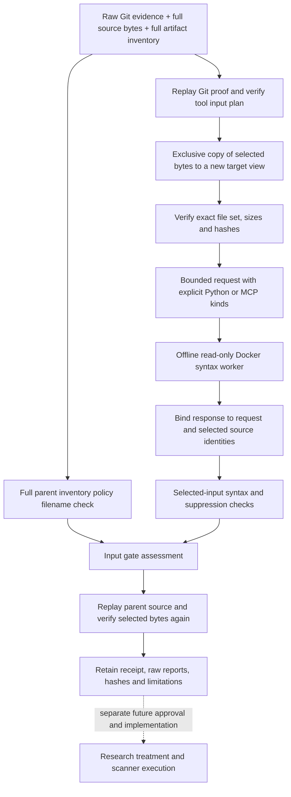

# Verified Input Views and Agent Input Validation

## Purpose and Boundary

This increment connects the [Git input plans](pinned-git-input-plans.md) to real selected-file
views and the existing isolated Python/MCP syntax worker. It implements file preparation and
input-policy assessment, not repository downloading, research admission or scanner execution.
The helper accepts only four registered controlled cases, never an arbitrary repository path.

The full inventory is retained even when most files are excluded from a tool view. In
particular, excluding `.agent-audit.yaml` cannot hide it from repository-level policy checks.
Existing scanner commands, fixture profiles and historical run/report contracts are unchanged.



## Library Contracts

| API / record | Responsibility |
|---|---|
| `ToolViewContext` | Full inventory, Git verification, tool plan, exact profile bytes and raw commit/tree evidence |
| `expected_tool_view` | Rebuild metadata from the selected/excluded plan; not a filesystem replay |
| `replay_parent_source` | Check the complete source tree on disk and replay its retained Git proof |
| `materialize_tool_view` | Replay parent, exclusively create a selected view, verify its bytes, then write the receipt |
| `verify_materialized_tool_view` | Compare a loaded receipt with its context and verify actual selected bytes |
| `build_agent_view_request` | Require an `agent-audit` plan and explicit supported kinds for exactly the selected files |
| `assess_agent_view_report` | Bind the worker response and combine selected-input checks with full parent policy context |

New records are `tool-input-view-v1` and `agent-view-assessment-v1`, under
`schemas/repository-view-v1/`. Regenerate with `tools/generate_repository_view_schemas.py`.
These derivatives do not modify the parent input plan, snapshot or historical scanner receipts.
The view binds the plan hash, Git verification hash, parent snapshot and selected content hash.
The assessment additionally binds the exact request and worker output hashes.

`input_gate_passed: true` means the selected inputs passed the current syntax/policy checks.
It does **not** mean they are safe, vulnerability-free, fully supported by the scanner, or
admitted to a research experiment. Both new records retain `execution_authorization: not-granted`;
assessments also retain `scanner_executed: false`. Do not treat schema validation alone as replay.

The caller must replay the full parent and verify the view before and after worker execution.
The helper does both; metadata-only request/assessment APIs cannot themselves prove filesystem
integrity. A failed worker execution produces retained diagnostic evidence, not a completed
assessment or a clean scan. Preparation-only output uses null gate results and `not-run` validation.

## Filesystem and Resource Rules

- Input/output paths must be nonoverlapping. The destination must be new under an existing
  plain directory. No overwrite or automatic removal of an earlier attempt is allowed.
- Refuse symlinks, Windows reparse points, hard-linked files, special entries, additional/missing
  files, unexpected directories and changed lengths/hashes. Check ancestors before resolving links.
- Copy bytes only. Git mode is retained as evidence; executable-mode preservation is not promised.
  No imports, checkout filters, hooks, package installation, builds or target tests are invoked.
- A failed copy remains inspectable without a successful `view.json`; retry in a new destination.
- The Git boundary retains its 10,000-file, 32-MiB/file and 256-MiB total limits. Reads are bounded
  by verified lengths, and files are held in memory. These are ceilings, not minimum RAM estimates.
- Agent requests retain the smaller existing limits: 64 files, 256 KiB/file, 1 MiB total and
  256 KiB serialized request. This increment does not batch or silently truncate larger selections.
- The worker uses the existing pinned validator image, no network/pulls, non-root execution,
  read-only root/input, dropped capabilities and no-new-privileges. The development profile limits
  each worker to two CPUs, 2 GiB memory, 256 PIDs and 120 seconds. No host credentials or socket mount.
- Policy filename checks use the full parent inventory. Suppression markers are inspected in
  selected files only; excluded content is not parsed. This is the existing conservative policy,
  not a semantic evaluation of arbitrary repository policy files.

Local preparation assumes a trusted, quiescent workspace. It is not a race-resistant sandbox
against another privileged process replacing paths concurrently. Links/reparse rejection has
targeted simulated tests; this is not exhaustive testing of every Windows reparse implementation.
Public acquisition, licenses, upstream defaults and research-profile applicability need separate
checks. The legacy dependency pilot remains dependency-only.

## Controlled Verification

`test_cases/development/input-views/cases.json` reuses the existing Git fixture and approved
Python/MCP development conditions. New Git identities were encoded with installed Git, separately
from the production verifier. Exact integration expectations are AI-authored engineering assertions,
not independently reviewed vulnerability labels or held-out data.

| Case | Parent / selected / excluded files | Expected input gate | Observed in both Docker repetitions |
|---|---|---|---|
| `excluded-policy` | 21 / 1 / 20 | Refuse | `target-policy:.agent-audit.yaml` despite its absence from the mounted view |
| `python-positive` | 1 / 1 / 0 | Pass syntax/policy checks | Passed; unsafe example not executed or declared safe |
| `mcp-positive` | 1 / 1 / 0 | Pass syntax/policy checks | Passed; no server launched or permission exercised |
| `python-inline-suppression` | 1 / 1 / 0 | Refuse | `suppression-marker:agent.py` |

The older five-selected/16-excluded Git walkthrough is unchanged. The new 21/1/20 selection is
a separate policy-handoff test. Eight validation-worker invocations are not eight security scans.

From the development checkout, using a new output path:

```powershell
uv run python tools/verify_input_views.py --prepare-only --output workspace/input-views-prepare-01
uv run python tools/verify_input_views.py --output workspace/input-views-validation-01
```

The second command requires the existing pinned validator image. See
[private image recovery](agent-image-reproduction.md) for availability limits. The helper retains
registry/config copies, full parent sources, raw Git evidence, inventories, input plans, selected
views, requests, worker source hashes, stdout/stderr, execution/cleanup receipts, assessments and
a SHA-256 manifest. Runtime home/cache directories are excluded from the evidence manifest.
Both repetitions must have equal normalized view/assessment results; execution timing is retained
separately and is not expected to be identical. A failure stops the helper with the partial attempt
retained. It does not rewrite the first attempt or claim the remaining cases ran.

Local verification on 2 October 2026: 551 tests passed on Windows and 551 in the pinned offline
Linux container on the same host; formatting, lint and typing passed. The 39 added checks include
mutation, overwrite, nested selection, copy failure, policy-context retention, response binding,
worker limits and schema/helper compatibility. All four real Docker cases repeated identically;
parent and view bytes were reverified after each. No scanner or target code executed in this
walkthrough. This establishes bounded integration behavior, not independent-host reproduction,
new public findings or completion of the same-repository research milestone.
